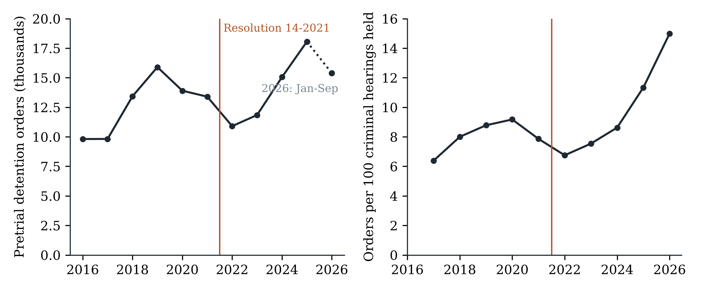
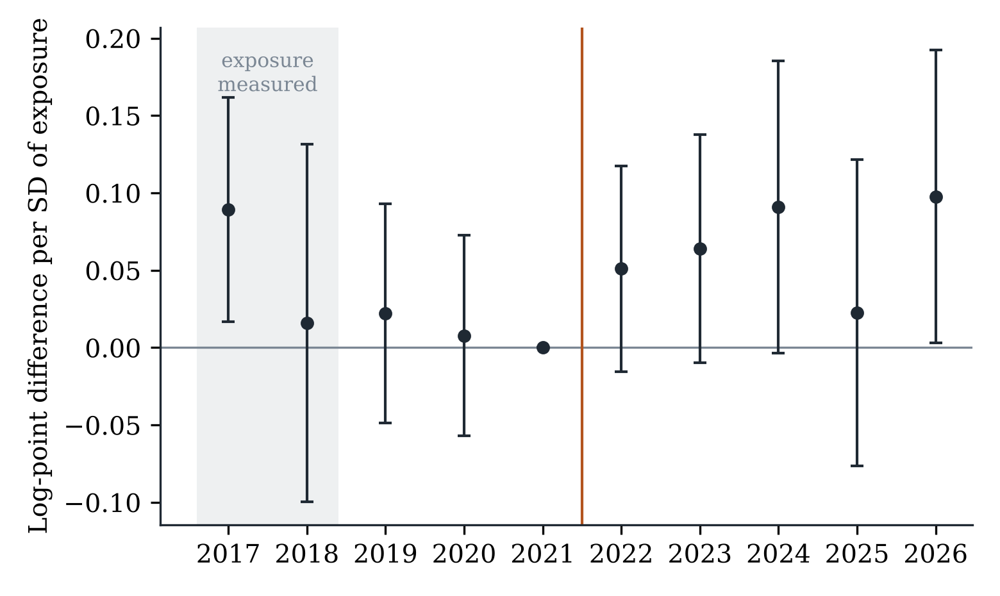
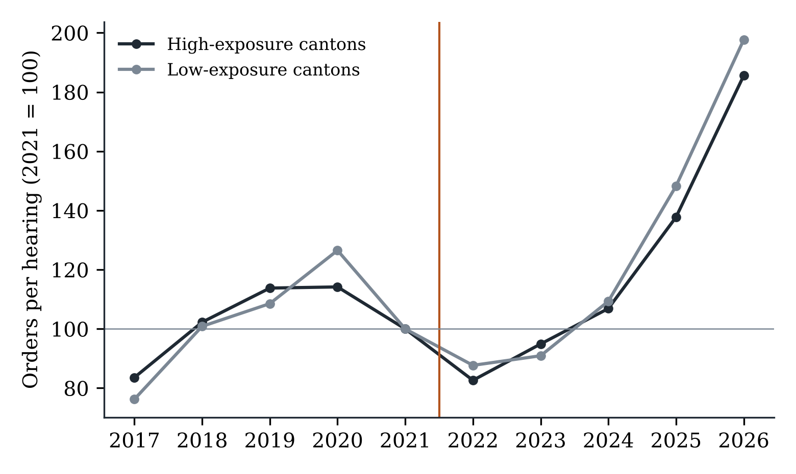
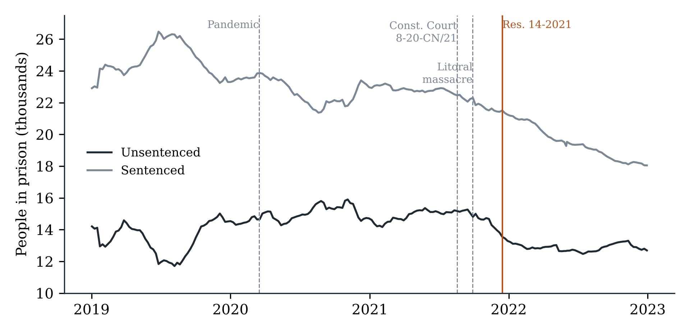

**Abstract**

Courts across Latin America have tried to rein in pretrial detention by tightening the reasons judges must give before ordering it. Whether such rules change behaviour is rarely tested. This article studies Resolution 14-2021 of Ecuador's National Court of Justice, a generally binding interpretation issued on 15 December 2021 that obliges prosecutors to prove, and judges to explain, why detention is necessary. Using newly assembled administrative records covering every committal order issued by Ecuadorian criminal courts between 2016 and September 2026, linked to hearings, homicides and weekly prison counts, I find that detention orders per hearing fell by 21 percent in 2022. Three pieces of evidence indicate that the resolution did not cause that fall. The decline began months earlier; it was no larger in the cantons where detention had been most routine, a differential reduction beyond 4 percent per standard deviation of prior reliance being ruled out; and the weekly count of unsentenced prisoners shows no break at the date of the resolution that placebo dates do not match. By 2025 detention orders stood 29 percent above their 2021 rate, with the legal standard unchanged. Pretrial detention in Ecuador followed the security cycle, not the doctrine. The results caution against treating reasoning requirements as a sufficient remedy for the overuse of detention.

**Keywords:** pretrial detention; judicial behaviour; compliance; prison overcrowding; Latin America; difference-in-differences

# 1. Introduction

Roughly four in ten people held in Ecuador's prisons have not been sentenced. The proportion is unremarkable by regional standards, and that is the problem: across Latin America, detention before trial has for decades operated less as an exception than as the ordinary response to an arrest (Inter-American Commission on Human Rights [IACHR], 2013, 2017; Bergman & Fondevila, 2021). The costs are well documented. Quasi-experimental studies from the United States show that being detained before trial raises the probability of conviction, mostly through guilty pleas, and worsens later employment and reoffending (Dobbie et al., 2018; Gupta et al., 2016; Heaton et al., 2017; Leslie & Pope, 2017; Stevenson, 2018a). A recent meta-analysis reaches the same verdict across dozens of studies (St. Louis, 2024).

What to do about it is less settled. Legislatures can narrow the offences for which detention is available, but they seldom do so when crime is politically salient. Apex courts have therefore stepped in with a different instrument: they leave the statute alone and raise the standard of reasoning. A judge may still order detention, yet must say why no milder measure would do, and the prosecutor must supply the evidence. The appeal of this approach is obvious. It costs nothing, it requires no vote, and it speaks the language of legality that judges are trained to respect. Its weakness is equally plain. A reasoning requirement constrains only if someone checks the reasons, and a judge who wishes to detain can usually find the words.

This article asks whether such a requirement works. The setting is Ecuador, where on 15 December 2021 the plenary of the National Court of Justice adopted Resolution 14-2021. Issued in the aftermath of the deadliest prison massacre in the country's history, the resolution clarified article 534 of the criminal code and told prosecutors and judges that every statutory requirement for detention had to be shown and reasoned case by case. Under Ecuadorian law the resolution binds every court in the country until the legislature provides otherwise. Its stated purpose was to reduce the number of prisoners held without sentence.

I assemble what is, to my knowledge, the first dataset that tracks pretrial detention decisions in a Latin American country at the level of the individual judge over a decade. The Judicial Council's open records report every committal order by court, judge and year from 2016 to September 2026, together with the reason for any later release. I link them to hearings held by the same judges, to homicide records, and to the prison service's weekly count of sentenced and unsentenced inmates.

The headline number looks like success. Detention orders fell from 13,400 in 2021 to 10,905 in 2022, a drop of 19 percent in a year in which homicides nearly doubled. Adjusted for caseload and local violence, the rate of detention per hearing fell by 21 percent. A before-and-after comparison would credit the resolution.

The comparison does not survive scrutiny, for three reasons. First, the timing is wrong. The detention rate had already fallen by about a fifth between 2020 and 2021, and the stock of unsentenced prisoners began to shrink in mid-September 2021, three months before the resolution. Second, there is no dose-response. A rule that demands justification should bite hardest where detention was least justified, that is, where it was ordered most freely. Yet cantons that had relied heavily on detention reduced it no more than cantons that had used it sparingly; the confidence interval excludes a differential decline larger than 4 percent per standard deviation of prior reliance. Third, the weekly prison series shows no discontinuity at the resolution date that cannot be matched by arbitrary placebo dates. On top of this, the decline did not last. By 2025 the detention rate was 29 percent above its 2021 level, and the number of unsentenced prisoners in 2026 exceeded any figure recorded before the resolution.

The contribution is threefold. The article adds a credible estimate, and a null one, to a literature on pretrial reform that is almost entirely about the United States and almost entirely about bail schedules and risk-assessment tools (Dobbie & Yang, 2021; Ouss & Stevenson, 2023; Sloan et al., 2025; Stevenson, 2018b). It speaks to the older question of when courts can change the behaviour of other actors, here the lower courts themselves (Hall, 2011; Rosenberg, 2008; Staton, 2010). And it offers a cautionary reading of a policy instrument that human-rights bodies routinely recommend. Null results deserve reporting when the prior expectation of an effect is strong (Abadie, 2020); in this case the institution that issued the rule, the press and much of the legal commentary expected one.

# 2. Institutional background

## 2.1 Pretrial detention in Ecuadorian law

The Constitution of 2008 treats detention before trial as exceptional and orders judges to prefer alternatives (art. 77). The Comprehensive Organic Criminal Code (COIP), in force since 2014, lists the conditions under which it may be ordered: sufficient evidence that an offence prosecutable by the state was committed, clear and precise evidence that the accused took part in it, indications that non-custodial measures would be insufficient to secure attendance at trial or enforcement of the sentence, and an offence punishable with more than one year of imprisonment (art. 534). Detention is requested by the prosecutor and decided by a judge at a hearing, most often the hearing that reviews an arrest in flagrante delicto. The Code offers non-custodial alternatives: periodic reporting, a ban on leaving the country, house arrest and electronic monitoring (art. 522).

Practice diverged from the text. Studies by the Public Defender's Office and regional organisations described detention hearings in which prosecutors recited the statutory formula and judges granted the request with little discussion of necessity. The IACHR, after an on-site visit prompted by the prison crisis, identified the overuse of pretrial detention as one of the structural causes of overcrowding (IACHR, 2022).

## 2.2 The resolution

In Ecuador the plenary of the National Court of Justice may issue resolutions "in case of doubt or obscurity of the laws", which are general and binding until the legislature provides otherwise (Organic Code of the Judiciary, art. 180.6). They are the closest domestic equivalent to a binding interpretive precedent and are distinct from ordinary case law.

Resolution 14-2021 was adopted on 15 December 2021 on the proposal of the president of the Court's criminal chamber. It makes three points, as the Court itself later summarised them. Pretrial detention is an exceptional measure, to be ordered as a last resort and only when no other precautionary measure would be useful and effective. The prosecutor must substantiate the requirements of article 534 and show a procedural risk that the alternatives cannot contain. And the judge's decision must be reasoned on four matters: that the facts fit an offence punishable with more than one year of imprisonment; that the evidence makes the accused's participation probable; that the alternatives are insufficient; and that detention is suitable, necessary and proportionate (Corte Nacional de Justicia, 2024). Contemporary press coverage presented it as an instrument to reduce the number of detainees without a sentence and stressed its binding force (González, 2021). Practitioners quoted at the time added a caveat that matters for what follows: the resolution, they said, contained nothing new and merely asked judges and prosecutors to comply with the Code.

## 2.3 What else was happening

The resolution did not arrive in a quiet period, and any credible evaluation has to deal with four concurrent developments.

On 18 August 2021 the Constitutional Court, in judgment 8-20-CN/21, struck down the provision of article 536 COIP that prohibited replacing pretrial detention with a milder measure for offences punishable with more than five years of imprisonment. From then on any detainee could ask for substitution, whatever the penalty attached to the charge.

On 28 September 2021 more than a hundred inmates were killed in the Litoral penitentiary in Guayaquil. The government declared a state of exception in the prison system and announced a decongestion policy that included pardons for sentenced prisoners. The massacre made overcrowding a matter of daily public debate, and judges ordering detention knew where detainees would be sent.

From 2022 violence outside the prisons escalated sharply. Intentional homicides in the cantons covered by this study rose from 2,343 in 2021 to 4,474 in 2022 and 7,718 in 2023. In January 2024 the President declared an internal armed conflict, and successive states of exception followed.

Finally, the prison service revised its classification of inmates in January 2023, when roughly 3,600 people moved from the unsentenced to the sentenced category in a single week. Analyses of the prison stock therefore stop at the end of 2022.

# 3. Expectations

If the resolution worked as intended, three patterns should appear. The use of detention should fall after December 2021 (H1). The fall should be larger where detention had been used most freely, because a demand for justification removes orders that cannot be justified and leaves the rest untouched (H2). And if the rule constrains judges independently of the political climate, the reduction should persist when public pressure for detention returns; if it does not constrain, the reduction should erode as violence rises (H3).

H2 carries the identifying weight. Because the resolution applied to every court on the same day, H1 alone cannot separate its effect from anything else that changed at the end of 2021. H2 turns a before-and-after comparison into a difference-in-differences with continuous exposure.

The exposure logic has precedent. Studies of sentencing guidelines exploit the fact that a common rule binds differently across judges with different prior practices (Bushway et al., 2012; Yang, 2015), and studies of risk-assessment tools find that responses depend on how far the recommendation departs from a judge's habits (Sloan et al., 2025; Stevenson, 2018b). The compliance literature gives reasons for doubt. Courts obtain compliance when their rulings are clear, when non-compliance is observable, and when someone has an interest in enforcing them (Carrubba et al., 2008; Hall, 2011; Staton, 2010). A reasoning requirement is clear enough, but compliance is hard to observe and the party best placed to enforce it, the defence, was already entitled to appeal.

# 4. Data

## 4.1 Sources

*Committal orders.* The Judicial Council publishes, from its case-management system, the number of committal orders (*boletas de encarcelamiento*) issued each year by court, subject matter and judge, classified by ground (pretrial detention, conviction, or preventive internment of adolescents) and by the reason for any later release. I use the file with a September 2026 cut-off, which covers 2016 to the first nine months of 2026, and keep criminal, traffic and domestic-violence matters. The file records 147,523 pretrial detention orders. Judge names, which the source publishes, are replaced by anonymous codes.

*Hearings.* A companion file reports hearings scheduled and held by court, judge and year from 2017. Hearings held in criminal matters serve as the measure of caseload.

*Homicides.* Record-level data on intentional homicides from the Ministry of the Interior, aggregated by canton and year, capture local violence. About 7.5 percent of homicides occur in cantons without a criminal court in the detention file and are not matched.

*Prison population.* The prison service (SNAI) publishes weekly national counts of sentenced and unsentenced inmates and installed capacity. I compile 509 weekly observations from January 2017 to September 2026.

All files were downloaded from the agencies' public portals, except the homicide spreadsheets, which were taken from a public mirror that preserves the official files and their checksums because the national open-data portal does not permit scripted access. A manifest with the address, retrieval date and SHA-256 hash of each file accompanies the replication package.

## 4.2 Units and measures

The main unit of analysis is the canton, the territorial jurisdiction of first-instance criminal courts. Court names are not harmonised between the orders file and the hearings file, whereas cantons are. The outcome is the number of pretrial detention orders in a canton-year. Exposure to the resolution is the canton's detention rate before it: orders divided by criminal hearings held in 2017 and 2018, standardised to mean zero and unit variance. Measuring exposure in 2017-2018 keeps it clear of the years used to test for diverging trends (2019 and 2020) and of the reference year (2021), which guards against mechanical mean reversion.

The estimation sample comprises the 129 cantons with at least 200 criminal hearings in the exposure window, observed from 2017 to 2026 (1,290 canton-years). They account for 97 percent of all detention orders issued in the period. The pre-resolution detention rate averages 7.9 orders per 100 hearings, with a standard deviation of 8.2 and an interquartile range from 3.1 to 9.7.

A judge-level panel serves as a check on composition. Judge identifiers are missing for 42 percent of orders in 2018 and 11 percent in 2019, but for 7 percent in 2020 and almost none thereafter, so the judge panel starts in 2019. It contains 985 judges and 5,887 judge-years.

## 4.3 A first look

**Table 1. Pretrial detention, caseload, violence and prison population, 2016-2026**

| Year | Detention orders | Hearings held | Orders per 100 hearings | Homicides | Later substituted (%) | Unsentenced prisoners | Overcrowding (%) |
|:--|--:|--:|--:|--:|--:|--:|--:|
| 2016 | 9,812 | – | – | 876 | 14.0 | – | – |
| 2017 | 9,821 | 153,822 | 6.4 | 880 | 14.5 | 12,381 | 40.9 |
| 2018 | 13,433 | 167,894 | 8.0 | 891 | 11.9 | 13,649 | 37.4 |
| 2019 | 15,902 | 181,082 | 8.8 | 1,104 | 11.6 | 13,427 | 39.2 |
| 2020 | 13,903 | 151,506 | 9.2 | 1,271 | 15.1 | 14,955 | 31.0 |
| 2021 | 13,400 | 170,438 | 7.9 | 2,343 | 16.4 | 14,729 | 27.1 |
| 2022 | 10,905 | 161,540 | 6.8 | 4,474 | 21.4 | 12,868 | 9.7 |
| 2023 | 11,846 | 157,100 | 7.5 | 7,718 | 19.0 | 10,494 | 12.6 |
| 2024 | 15,054 | 174,527 | 8.6 | 6,605 | 21.1 | 11,752 | 18.9 |
| 2025 | 18,057 | 159,208 | 11.3 | 8,509 | 21.5 | 12,358 | 30.1 |
| 2026ᵃ | 15,390 | 102,637 | 15.0 | 5,784 | 16.9 | 15,225 | 38.1 |

*Note.* Orders and hearings are from the Judicial Council (criminal, traffic and domestic-violence matters); hearings are available from 2017. Homicides refer to cantons with a criminal court. "Later substituted" is the share of each year's detention orders that ended with a non-custodial measure; recent cohorts are right-censored. Prison figures are annual means of weekly SNAI counts; the unsentenced series is redefined in January 2023. ᵃ January to September.

Table 1 sets out the national picture. Detention orders rose from under 10,000 a year in 2016-2017 to nearly 16,000 in 2019, eased in 2020 and 2021, and dropped to 10,905 in 2022. They then climbed without interruption to 18,057 in 2025, and the first nine months of 2026 already total 15,390. Relative to caseload the pattern is the same: 9.2 orders per 100 hearings in 2020, 6.8 in 2022, 11.3 in 2025. Figure 1 plots both series.

Two features of Table 1 anticipate the argument. The detention rate peaked in 2020, not 2021; the downturn was under way a year before the resolution. And the ratio of detention orders to homicides collapsed from 14 in 2019 to 1.5 in 2023, which shows how weakly detention tracked lethal violence during the surge and why a control for violence is needed.

# 5. Empirical strategy

## 5.1 Aggregate change

I first describe the aggregate change with a Poisson model with canton fixed effects,

$$E[y_{ct}] = \exp\big(\alpha_c + \textstyle\sum_{t \neq 2021} \tau_t + \gamma \log(1 + h_{ct}) + \log n_{ct}\big),$$

where $y_{ct}$ is the number of detention orders in canton $c$ and year $t$, $h_{ct}$ the number of homicides and $n_{ct}$ the number of criminal hearings held, entered as an offset so that the coefficients describe the rate of detention per hearing. The year effects $\tau_t$ are relative to 2021. They are descriptive: nothing identifies them separately from other national shocks.

## 5.2 Exposure design

The causal question is addressed by

$$E[y_{ct}] = \exp\big(\alpha_c + \lambda_t + \textstyle\sum_{t \neq 2021} \beta_t\, (z_c \times 1[\text{year}=t]) + \gamma \log(1 + h_{ct}) + \log n_{ct}\big),$$

where $z_c$ is standardised pre-resolution reliance on detention and $\lambda_t$ are year effects. Each $\beta_t$ is the difference, in log points, in the detention rate between cantons one standard deviation apart in prior reliance, relative to the same difference in 2021. Under H2, $\beta_t < 0$ for $t \geq 2022$. The coefficients for 2019 and 2020 test whether high- and low-reliance cantons were on different paths beforehand. A pooled version replaces the post-period interactions with two terms, for 2022-2023 and for 2024-2026.

The Poisson pseudo-maximum-likelihood estimator is consistent under correct specification of the conditional mean whatever the distribution of the counts, handles zeros and, unlike log-linear models, is not biased by heteroskedasticity (Santos Silva & Tenreyro, 2006; Wooldridge, 1999). Models are estimated with the routines described by Correia et al. (2020). Standard errors are clustered by canton; because the number of provinces is small (24), province-level clustering is reported as a sensitivity check and inference is complemented with a permutation test that reassigns exposure across cantons 500 times.

With continuous exposure, $\beta_t$ identifies an average causal response only under a stronger form of parallel trends than the binary case requires: cantons at different exposure levels must have followed the same path absent the rule, and would have responded alike to the same dose (Callaway et al., 2024; Roth et al., 2023). I therefore also report a binary version that compares cantons above and below median reliance.

## 5.3 Robustness and placebo tests

Robustness checks add province-by-year fixed effects, which absorb any shock common to the courts of a province, including states of exception and regional crime waves; drop Guayaquil and Quito; drop the pandemic year; and omit the homicide control. Two placebo exercises follow. One assigns a fictitious resolution to 2020 using only pre-resolution data. The other uses committals following conviction, an outcome the resolution did not address.

A within-judge specification replaces canton effects with judge effects and assigns each judge the exposure of the canton where he or she held most hearings. It asks whether the same judges changed behaviour, which rules out the possibility that turnover on the bench drives the results.

## 5.4 Discontinuity in the prison stock

Annual court data cannot date a change to the week. The weekly prison count can. I estimate the jump in the number of unsentenced prisoners at 15 December 2021 with a local linear regression in time on each side of that date, using bandwidths of 8, 12 and 20 weeks and Newey-West standard errors. Estimates of this kind are sensitive to serial correlation and to unrelated events near the cut-off (Hausman & Rapson, 2018). I therefore compare the estimated jump with the distribution of jumps obtained at every other week between January 2018 and June 2022, excluding dates whose window overlaps the resolution or the pandemic releases of 2020. A stock responds to a change in inflows gradually, so the test is informative mainly about abrupt effects, such as a wave of reviews of existing detentions.

# 6. Results

## 6.1 The aggregate decline and its reversal

**Table 2. Detention rate by year relative to 2021**

| Year | Coefficient (SE) | Change vs. 2021 (%) | 95% CI (%) |
|:--|--:|--:|--:|
| 2017 | -0.062 (0.061) | -6.0 | [-16.6, +5.8] |
| 2018 | 0.079 (0.052) | +8.3 | [-2.3, +20.0] |
| 2019 | 0.203*** (0.042) | +22.5 | [+12.9, +32.9] |
| 2020 | 0.238*** (0.027) | +26.9 | [+20.4, +33.7] |
| 2022 | -0.236*** (0.040) | -21.0 | [-27.0, -14.5] |
| 2023 | -0.151** (0.077) | -14.0 | [-26.0, -0.1] |
| 2024 | 0.038 (0.084) | +3.8 | [-11.9, +22.4] |
| 2025 | 0.254*** (0.086) | +28.9 | [+9.0, +52.5] |
| 2026 | 0.601*** (0.055) | +82.5 | [+63.7, +103.4] |

*Note.* Poisson regression of detention orders on year indicators with canton fixed effects, log(1 + homicides) and log hearings held as offset; 129 cantons, 1,290 observations. Standard errors clustered by canton. * p < 0.10, ** p < 0.05, *** p < 0.01.

Net of canton effects, caseload and homicides, the detention rate in 2022 was 21 percent below its 2021 level (Table 2). It remained 14 percent lower in 2023, returned to the 2021 level in 2024 and stood 29 percent above it in 2025. The estimate for 2026, based on nine months, is higher still and should be read with caution, since hearings and orders may not be registered with the same delay.

The same table shows that 2021 was not a stable baseline. The rate in 2020 was 27 percent above that of 2021; put differently, detention per hearing had already fallen by about a fifth in the year before the resolution took effect. The resolution was adopted on 15 December, so virtually none of the 2021 decline can be attributed to it.

## 6.2 No differential response by prior reliance

Figure 2 and Table 3 report the exposure design. The coefficients for 2019 and 2020 are small (0.022 and 0.008) and jointly indistinguishable from zero (p = 0.82): before the resolution, cantons with high and low reliance on detention moved together. After it, they continued to do so. None of the post-period coefficients is negative. The point estimates are positive, between 0.02 and 0.10, and mostly insignificant, meaning that if anything high-reliance cantons reduced detention slightly less than the rest.

**Table 3. Event-study estimates by pre-resolution reliance on detention**

| Year | Continuous exposure (per SD) | Above-median exposure |
|:--|--:|--:|
| 2017 | 0.089** (0.037) | 0.214** (0.094) |
| 2018 | 0.016 (0.059) | 0.007 (0.079) |
| 2019 | 0.022 (0.036) | 0.075 (0.063) |
| 2020 | 0.008 (0.033) | -0.053 (0.058) |
| 2022 | 0.051 (0.034) | -0.042 (0.069) |
| 2023 | 0.064* (0.038) | 0.035 (0.100) |
| 2024 | 0.091* (0.048) | 0.057 (0.111) |
| 2025 | 0.022 (0.051) | -0.032 (0.110) |
| 2026 | 0.098** (0.048) | -0.005 (0.098) |
| Joint test, 2019-2020 (p) | 0.815 | 0.253 |

*Note.* Poisson regressions with canton and year fixed effects, log(1 + homicides) and log hearings as offset. Exposure is measured in 2017-2018; 2021 is the reference year. Standard errors clustered by canton. * p < 0.10, ** p < 0.05, *** p < 0.01.

**Table 4. Pooled difference-in-differences estimates**

| Specification | Exposure × 2022-2023 | 95% CI (%) | Exposure × 2024-2026 | N |
|:--|--:|--:|--:|--:|
| Baseline | 0.037 (0.042) | [-4.3, +12.6] | 0.047 (0.045) | 1290 |
| Province-year FE | -0.099 (0.075) | [-21.9, +5.0] | -0.059 (0.088) | 1280 |
| Cluster province | 0.037 (0.024) | [-1.1, +8.9] | 0.047 (0.035) | 1290 |
| No Guayaquil/Quito | -0.009 (0.066) | [-12.9, +12.7] | 0.045 (0.082) | 1270 |
| No homicide control | 0.068 (0.045) | [-2.0, +17.0] | 0.081 (0.051) | 1290 |
| Binary exposure | -0.042 (0.088) | [-19.3, +13.9] | -0.035 (0.104) | 1290 |
| Placebo outcome: conviction committals | -0.244*** (0.054) | [-29.4, -13.0] | -0.180 (0.123) | 1290 |
| Drop 2020 (pandemic) | 0.031 (0.042) | [-4.9, +11.9] | 0.040 (0.043) | 1161 |
| Pre-period only 2019-2021 | 0.049 (0.040) | [-2.9, +13.7] | 0.058 (0.047) | 1032 |

*Note.* Poisson regressions of detention orders (committals after conviction in the placebo row) with canton and year fixed effects unless stated, log hearings as offset. Exposure is standardised pre-resolution reliance, or an above-median indicator in the binary row. Standard errors clustered by canton unless stated. * p < 0.10, ** p < 0.05, *** p < 0.01.

Table 4 pools the post-period. In the baseline specification a one-standard-deviation difference in prior reliance is associated with a change of 3.8 percent in the detention rate in 2022-2023, with a 95 percent confidence interval from -4.3 to 12.6 percent. The data therefore rule out a differential decline larger than 4.3 percent per standard deviation, or about 3.5 percent between cantons at the 25th and 75th percentiles of reliance. To put that bound in perspective, the national decline was 21 percent. Had the resolution produced that decline by trimming unjustified orders, it would have had to do so in equal proportion in courts that detained in three of every hundred hearings and in courts that detained in ten.

The conclusion holds across specifications. With province-by-year effects, which use only variation among cantons of the same province, the estimate turns negative (-9.4 percent) but is imprecise and insignificant; that demanding specification cannot exclude a differential decline of up to 22 percent, so the bound stated above belongs to the baseline model. It is essentially zero without Guayaquil and Quito, and unchanged when 2020 is dropped. The binary comparison gives -4.1 percent with a standard error of 8.8. The permutation p-value for the baseline estimate is 0.51. Figure 3 shows the raw rates for cantons above and below median reliance, indexed to 2021: the two lines are hard to tell apart in the two years after the resolution.

The fictitious 2020 resolution yields a coefficient of -0.011 (standard error 0.031), as it should. The second placebo is less reassuring about itself than about the main result: committals after conviction display strong differential pre-trends by exposure (joint p < 0.001), which disqualifies them as a comparison outcome. I report the estimate for transparency and draw no inference from it.

## 6.3 Within judges

**Table 5. Within-judge estimates, 2019-2026**

| Specification | Exposure × 2022-2023 | Exposure × 2024-2026 | Judges | Judge-years |
|:--|--:|--:|--:|--:|
| Judge FE + year FE | 0.109** (0.043) | 0.198*** (0.052) | 985 | 5,887 |
| Judge FE + province-year FE | -0.029 (0.070) | 0.116 (0.103) | 985 | 5,887 |

*Note.* Poisson regressions of detention orders by judge-year with log hearings held as offset. Each judge carries the exposure of the canton where he or she held most hearings. Standard errors clustered by canton. * p < 0.10, ** p < 0.05, *** p < 0.01.

Composition does not explain the null. Following the same 985 judges, those sitting in high-reliance cantons did not reduce detention more than their peers after the resolution (Table 5). With judge and year effects the differential is positive and significant; with province-by-year effects it is -2.9 percent and insignificant. Neither version shows the negative gradient H2 predicts.

## 6.4 The prison stock

Figure 4 plots the weekly prison counts. The number of unsentenced prisoners peaked at 15,263 on 15 September 2021 and had fallen to 13,541 by 15 December, the day the resolution was adopted. The slide of 1,722 people in three months preceded the rule. It began within weeks of the Constitutional Court's ruling on substitution and accelerated after the Litoral massacre. After the resolution the series continued downward at a slower pace and flattened from February 2022 at around 12,800.

**Table 6. Discontinuity in the weekly prison population at the resolution date**

| Outcome | Bandwidth (weeks) | Jump at 15 Dec 2021 | HAC SE | SD of placebo jumps | Placebo dates | Share of placebos at least as large |
|:--|--:|--:|--:|--:|--:|--:|
| Unsentenced prisoners | 8 | -270 | 103 | 346 | 173 | 0.33 |
| Unsentenced prisoners | 12 | -422 | 128 | 441 | 157 | 0.22 |
| Unsentenced prisoners | 20 | -818 | 221 | 829 | 125 | 0.20 |
| Sentenced prisoners | 8 | 96 | 28 | 308 | 173 | 0.66 |
| Sentenced prisoners | 12 | 126 | 49 | 359 | 157 | 0.76 |
| Sentenced prisoners | 20 | 271 | 94 | 600 | 125 | 0.46 |
| Unsentenced share | 8 | -0.0059 | 0.0019 | 0.0087 | 173 | 0.41 |
| Unsentenced share | 12 | -0.0088 | 0.0025 | 0.0106 | 157 | 0.31 |
| Unsentenced share | 20 | -0.0174 | 0.0047 | 0.0195 | 125 | 0.23 |

*Note.* Local linear regressions in time with separate slopes on each side of the cut-off. Placebo cut-offs are all weeks from January 2018 to June 2022 whose window overlaps neither the resolution nor the pandemic releases of 2020.

Local linear estimates confirm what the figure suggests (Table 6). With a 12-week bandwidth the estimated jump at the resolution date is -422 unsentenced prisoners. Jumps of that size or larger occur at 22 percent of placebo dates; with bandwidths of 8 and 20 weeks the corresponding shares are 33 and 20 percent. The share of unsentenced prisoners in the total barely moved, from 39.7 percent in 2021 to 39.9 percent in 2022, because the sentenced population was falling too.

## 6.5 What did change

One margin did move. Among people committed to pretrial detention in 2019, 11.6 percent were later released because detention was replaced by a milder measure. The share rose to 15.1 percent for those committed in 2020, 16.4 percent for 2021 and 21.4 percent for 2022, and has stayed near that level (Table 1). The rise predates the resolution and affects cohorts detained before it, which points to the Constitutional Court's August 2021 ruling on substitution as the more plausible origin. That ruling changed what judges were permitted to do; the resolution changed what they were required to say. Later cohorts are right-censored, since many of their cases are still open, so the figures for recent years are lower bounds.

# 7. Discussion

Taken together, the evidence supports H1 only in the trivial sense that detention was lower in 2022 than in 2021. It contradicts H2, and it fits the pessimistic branch of H3: the reduction vanished as violence rose, and by 2025 judges were ordering detention at a higher rate than at any point in the series, under the same resolution.

Why did a binding rule leave so little trace? The first explanation is that the resolution added no new constraint. It restated requirements that the Code already imposed and that the Constitution already framed as exceptional. Practitioners said so when it was issued. A rule changes behaviour when it alters what an actor may do or what happens when the actor does it; the resolution did neither. It created no new ground of appeal, no reporting duty and no sanction, and it left untouched the prosecutor's incentive to ask for detention and the judge's exposure to public blame if a released defendant reoffends.

The second explanation concerns monitoring. Compliance with a reasoning requirement is satisfied by reasons, and reasons are cheap. A judge inclined to detain can meet the standard by lengthening the decision. The administrative data cannot see the text of orders, but the absence of any gradient by prior reliance is what one would expect if courts adjusted their wording and not their decisions. Research on risk-assessment instruments in the United States reports a similar sequence, in which an initial change in release rates fades as judges revert to earlier habits (Sloan et al., 2025; Stevenson, 2018b).

The third explanation is that the forces pulling the other way were stronger. The drop in 2021-2022 coincided with a moment when the costs of detention were unusually visible: hundreds of prisoners had been killed, the system was under a state of exception, and sending a defendant to prison could amount to sending him into a massacre. The rebound coincided with the opposite climate, an unprecedented homicide wave followed by the declaration of an internal armed conflict. Judges' detention decisions respond to what they believe about the consequences of error (Arnold et al., 2018; Kleinberg et al., 2018), and those beliefs shifted far more over these years than the doctrine did. The resolution may itself be best understood as a product of the decongestion moment and not as its cause: the Court acted when the judiciary was already moving.

For the debate on judicial impact, the case is a clean instance of a court addressing its own hierarchy. Scepticism about courts as agents of change usually rests on their dependence on other branches for implementation (Rosenberg, 2008). Here the addressees were judges, bound by law to follow the plenary, and the instruction was within their sole power to carry out. If a court cannot move its own lower courts by declaration, the limits of declaratory reform lie closer to home than that literature assumes.

For policy, the lesson is about instruments. International bodies have long urged states to ensure that detention orders are individually reasoned (IACHR, 2013, 2017). Nothing here suggests that the advice is wrong, only that it is insufficient. The one margin that moved, substitution, did so after a ruling that removed a legal prohibition. Reforms that change the choice set, such as narrowing the offences eligible for detention, setting hard time limits with automatic release, or funding alternatives so that they are available at the hearing, operate on what judges can do. They are costlier and politically harder, which is presumably why reasoning requirements are preferred.

# 8. Limitations

Four limitations qualify these conclusions. The court data are annual, so the timing argument for orders rests on the comparison of 2020, 2021 and 2022 and on the weekly prison series, not on a sharp event study. Because the resolution was national, no untreated courts exist; the exposure design identifies a differential effect, and a uniform proportional effect on all courts cannot be excluded by it. That possibility is, however, hard to reconcile with a decline that started before the rule and was fully reversed while the rule remained in force. I lack arrest counts, the natural denominator for detention decisions, because the national portal that hosts them does not allow automated access; hearings held are a broader measure of caseload. Finally, the administrative records do not contain the text of decisions, so I cannot observe whether reasoning became more thorough, an outcome that has value in itself even when the result is unchanged.

# 9. Conclusion

Ecuador's highest ordinary court told every criminal judge in the country to justify pretrial detention properly, and for a year the numbers appeared to obey. They were obeying something else. The decline in detention began before the resolution, was indifferent to how much each jurisdiction had to correct, left no mark on the weekly prison count at the moment the rule took effect, and gave way to record levels once the security crisis deepened. In late 2026 more people are held without sentence in Ecuador than when the Court acted.

Reasoning requirements are attractive because they are cheap. The evidence presented here suggests they are cheap in both senses. Reducing pretrial detention is likely to require changing what judges are able to decide and what it costs them to decide it, and not only what they must write.

# Data and code availability

All data are public. The replication package contains the original files as published, their checksums, and the code that produces every table and figure in the article.

# References

Abadie, A. (2020). Statistical nonsignificance in empirical economics. *American Economic Review: Insights, 2*(2), 193-208. https://doi.org/10.1257/aeri.20190252

Arnold, D., Dobbie, W., & Yang, C. S. (2018). Racial bias in bail decisions. *The Quarterly Journal of Economics, 133*(4), 1885-1932. https://doi.org/10.1093/qje/qjy012

Bergman, M., & Fondevila, G. (2021). *Prisons and crime in Latin America*. Cambridge University Press. https://doi.org/10.1017/9781108768238

Bushway, S. D., Owens, E. G., & Piehl, A. M. (2012). Sentencing guidelines and judicial discretion: Quasi-experimental evidence from human calculation errors. *Journal of Empirical Legal Studies, 9*(2), 291-319. https://doi.org/10.1111/j.1740-1461.2012.01254.x

Callaway, B., Goodman-Bacon, A., & Sant'Anna, P. H. C. (2024). *Difference-in-differences with a continuous treatment* (NBER Working Paper No. 32117). National Bureau of Economic Research. https://doi.org/10.3386/w32117

Carrubba, C. J., Gabel, M., & Hankla, C. (2008). Judicial behavior under political constraints: Evidence from the European Court of Justice. *American Political Science Review, 102*(4), 435-452. https://doi.org/10.1017/S0003055408080350

Correia, S., Guimarães, P., & Zylkin, T. (2020). Fast Poisson estimation with high-dimensional fixed effects. *The Stata Journal, 20*(1), 95-115. https://doi.org/10.1177/1536867X20909691

Dobbie, W., Goldin, J., & Yang, C. S. (2018). The effects of pre-trial detention on conviction, future crime, and employment: Evidence from randomly assigned judges. *American Economic Review, 108*(2), 201-240. https://doi.org/10.1257/aer.20161503

Dobbie, W., & Yang, C. S. (2021). *The US pretrial system: Balancing individual rights and public interests* (NBER Working Paper No. 29332). National Bureau of Economic Research. https://doi.org/10.3386/w29332

González, M. A. (2021, December 22). Corte Nacional busca frenar hacinamiento carcelario con dos resoluciones. *Primicias*. https://www.primicias.ec/noticias/en-exclusiva/carceles-corte-nacional-frenar-hacinamiento/

Gupta, A., Hansman, C., & Frenchman, E. (2016). The heavy costs of high bail: Evidence from judge randomization. *The Journal of Legal Studies, 45*(2), 471-505. https://doi.org/10.1086/688907

Hall, M. E. K. (2011). *The nature of Supreme Court power*. Cambridge University Press. https://doi.org/10.1017/CBO9780511933943

Hausman, C., & Rapson, D. S. (2018). Regression discontinuity in time: Considerations for empirical applications. *Annual Review of Resource Economics, 10*, 533-552. https://doi.org/10.1146/annurev-resource-121517-033306

Heaton, P., Mayson, S., & Stevenson, M. (2017). The downstream consequences of misdemeanor pretrial detention. *Stanford Law Review, 69*(3), 711-794.

Inter-American Commission on Human Rights. (2013). *Report on the use of pretrial detention in the Americas* (OEA/Ser.L/V/II, Doc. 46/13). Organization of American States.

Inter-American Commission on Human Rights. (2017). *Report on measures aimed at reducing the use of pretrial detention in the Americas* (OEA/Ser.L/V/II.163, Doc. 105). Organization of American States.

Inter-American Commission on Human Rights. (2022). *Persons deprived of liberty in Ecuador* (approved 21 February 2022). Organization of American States.

Kleinberg, J., Lakkaraju, H., Leskovec, J., Ludwig, J., & Mullainathan, S. (2018). Human decisions and machine predictions. *The Quarterly Journal of Economics, 133*(1), 237-293. https://doi.org/10.1093/qje/qjx032

Leslie, E., & Pope, N. G. (2017). The unintended impact of pretrial detention on case outcomes: Evidence from New York City arraignments. *The Journal of Law and Economics, 60*(3), 529-557. https://doi.org/10.1086/695285

Ouss, A., & Stevenson, M. (2023). Does cash bail deter misconduct? *American Economic Journal: Applied Economics, 15*(3), 150-182. https://doi.org/10.1257/app.20210349

Rosenberg, G. N. (2008). *The hollow hope: Can courts bring about social change?* (2nd ed.). University of Chicago Press.

Roth, J., Sant'Anna, P. H. C., Bilinski, A., & Poe, J. (2023). What's trending in difference-in-differences? A synthesis of the recent econometrics literature. *Journal of Econometrics, 235*(2), 2218-2244. https://doi.org/10.1016/j.jeconom.2023.03.008

Santos Silva, J. M. C., & Tenreyro, S. (2006). The log of gravity. *The Review of Economics and Statistics, 88*(4), 641-658. https://doi.org/10.1162/rest.88.4.641

Sloan, C., Naufal, G., & Caspers, H. (2025). The effect of risk assessment scores on judicial behavior and defendant outcomes. *Journal of Human Resources, 60*(5), 1778-1810. https://doi.org/10.3368/jhr.0221-11470R3

St. Louis, S. (2024). The pretrial detention penalty: A systematic review and meta-analysis of pretrial detention and case outcomes. *Justice Quarterly, 41*(3), 347-370. https://doi.org/10.1080/07418825.2023.2193624

Staton, J. K. (2010). *Judicial power and strategic communication in Mexico*. Cambridge University Press. https://doi.org/10.1017/CBO9780511750632

Stevenson, M. T. (2018a). Distortion of justice: How the inability to pay bail affects case outcomes. *The Journal of Law, Economics, and Organization, 34*(4), 511-542. https://doi.org/10.1093/jleo/ewy019

Stevenson, M. T. (2018b). Assessing risk assessment in action. *Minnesota Law Review, 103*(1), 303-384.

Wooldridge, J. M. (1999). Distribution-free estimation of some nonlinear panel data models. *Journal of Econometrics, 90*(1), 77-97. https://doi.org/10.1016/S0304-4076(98)00033-5

Yang, C. S. (2015). Free at last? Judicial discretion and racial disparities in federal sentencing. *The Journal of Legal Studies, 44*(1), 75-111. https://doi.org/10.1086/680989

**Legal sources**

Constitución de la República del Ecuador (2008), art. 77.

Código Orgánico Integral Penal (2014), arts. 522, 534, 536.

Código Orgánico de la Función Judicial (2009), art. 180.6.

Corte Constitucional del Ecuador, Sentencia No. 8-20-CN/21, 18 August 2021.

Corte Nacional de Justicia, Pleno, Resolución No. 14-2021, 15 December 2021.

Corte Nacional de Justicia. (2024). Habeas corpus judgment summarising Resolución No. 14-2021. *Registro Oficial, Edición Jurídica* No. 415, 31 May 2024.

**Data sources**

Consejo de la Judicatura. (2026). *Portal de Estadística Judicial: Boletas; Audiencias* [Data sets, September 2026 cut-off].

Ministerio del Interior. (2026). *Homicidios intencionales 2014-2026* [Data set].

Servicio Nacional de Atención Integral a Personas Adultas Privadas de la Libertad y a Adolescentes Infractores. (2017-2026). *Reportes semanales y mensuales de personas privadas de libertad* [Data sets].
