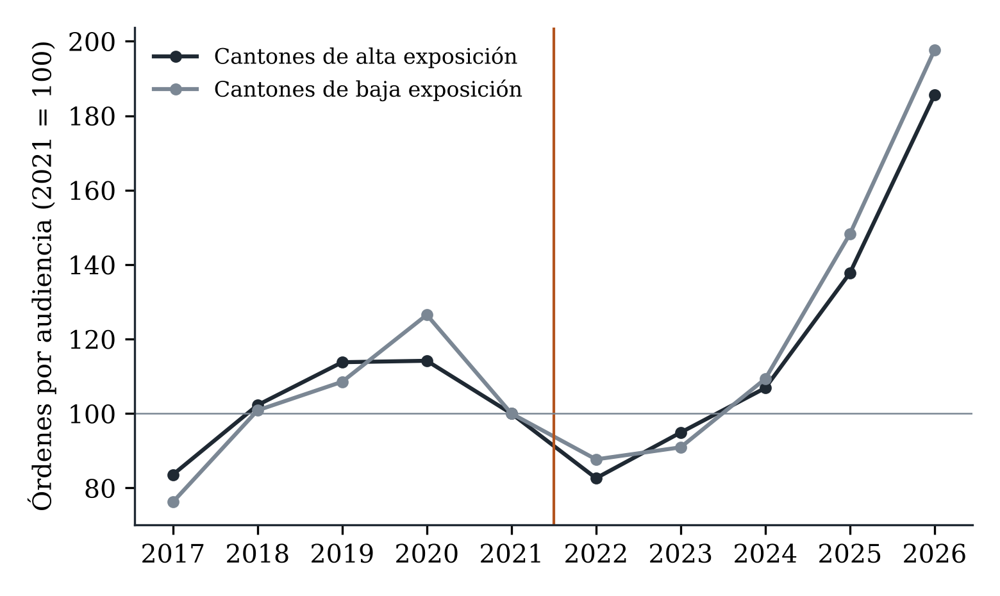
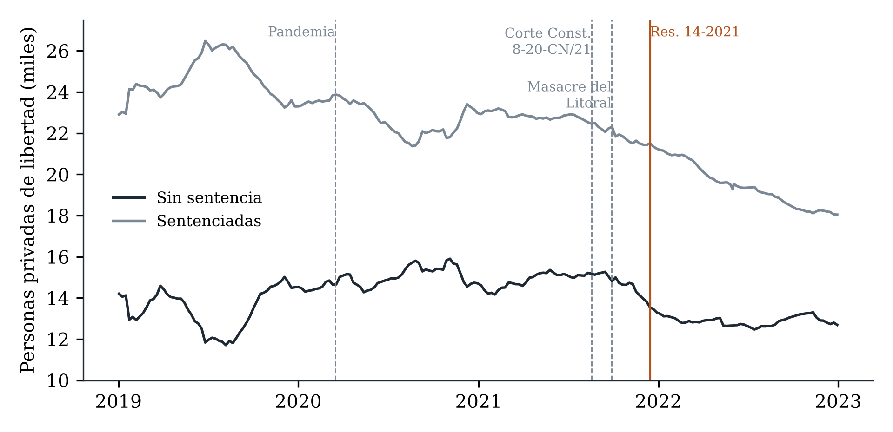

::: {custom-style="PC Titulo"}
¿Puede un tribunal contener la prisión preventiva? Evidencia de una resolución obligatoria de la Corte Nacional de Justicia del Ecuador
:::

::: {custom-style="PC Centro"}
Can a court curb pretrial detention? Evidence from a binding resolution of Ecuador's National Court of Justice
:::

::: {custom-style="PC Centro"}
[Nombre y apellidos del autor]^[[Indicar aquí si el artículo es producto de un proyecto de investigación financiado o de una tesis de magíster o doctorado. Si no corresponde, eliminar esta nota.]]
:::

::: {custom-style="PC Centro"}
[Grado académico, cargo o adscripción institucional, ciudad y país]
:::

::: {custom-style="PC Centro"}
[Dirección electrónica]
:::

**Resumen**

Varios tribunales latinoamericanos han intentado contener la prisión preventiva exigiendo una motivación más rigurosa. Rara vez se ha comprobado si estas reglas cambian la conducta judicial. Este artículo evalúa la Resolución 14-2021 de la Corte Nacional de Justicia del Ecuador, de carácter general y obligatorio, que desde el 15 de diciembre de 2021 exige a la fiscalía probar, y al juez motivar, la necesidad de la medida. Con registros administrativos de todas las boletas de encarcelamiento emitidas entre 2016 y septiembre de 2026, vinculados con audiencias, homicidios y conteos semanales de población penitenciaria, se observa que las órdenes de prisión preventiva por audiencia cayeron un 21 % en 2022. Tres hallazgos indican que la resolución no causó esa caída. El descenso empezó antes; no fue mayor donde la medida era más habitual, y se descarta una reducción diferencial superior al 4 % por desviación estándar de uso previo; y la serie semanal de presos sin sentencia no muestra en la fecha de la resolución un quiebre que no aparezca también en fechas placebo. En 2025 la tasa superaba en un 29 % la de 2021. La prisión preventiva siguió el ciclo de la seguridad, no la doctrina.

**Palabras clave:** prisión preventiva, comportamiento judicial, cumplimiento de precedentes, hacinamiento carcelario, Ecuador

**Abstract**

Courts across Latin America have tried to rein in pretrial detention by tightening the reasons judges must give before ordering it. Whether such rules change behaviour is rarely tested. This article studies Resolution 14-2021 of Ecuador's National Court of Justice, a generally binding interpretation issued on 15 December 2021 that obliges prosecutors to prove, and judges to explain, why detention is necessary. Using administrative records of every committal order issued by Ecuadorian criminal courts between 2016 and September 2026, linked to hearings, homicides and weekly prison counts, I find that detention orders per hearing fell by 21 percent in 2022. Three findings indicate that the resolution did not cause that fall. The decline began earlier; it was no larger where detention had been most routine, a differential reduction beyond 4 percent per standard deviation of prior use being ruled out; and the weekly count of unsentenced prisoners shows no break at the resolution date that placebo dates do not also show. By 2025 the detention rate stood 29 percent above its 2021 level. Pretrial detention followed the security cycle, not the doctrine.

**Keywords:** pretrial detention, judicial behaviour, compliance, prison overcrowding, Ecuador

# Introducción

Cerca de cuatro de cada diez personas recluidas en las cárceles ecuatorianas no tienen sentencia. La proporción no llama la atención en la región, y ahí reside el problema: en América Latina la prisión preventiva ha funcionado durante décadas menos como excepción que como respuesta ordinaria a una detención.^[COMISIÓN INTERAMERICANA DE DERECHOS HUMANOS (2013), passim; COMISIÓN INTERAMERICANA DE DERECHOS HUMANOS (2017), passim; BERGMAN y FONDEVILA (2021), passim.] Sus costos están bien documentados. Estudios cuasiexperimentales en Estados Unidos muestran que permanecer detenido antes del juicio aumenta la probabilidad de condena, sobre todo por la vía de la declaración de culpabilidad, y empeora el empleo y la reincidencia posteriores.^[DOBBIE et al. (2018), pp. 201-240; GUPTA et al. (2016), pp. 471-505; HEATON et al. (2017), pp. 711-794; LESLIE y POPE (2017), pp. 529-557; STEVENSON (2018a), pp. 511-542.] Un metaanálisis reciente llega a la misma conclusión tras revisar decenas de estudios.^[ST. LOUIS (2024), pp. 347-370.]

Qué hacer al respecto es una cuestión menos resuelta. El legislador puede reducir los delitos para los que procede la medida, pero rara vez lo hace cuando la delincuencia domina la agenda política. Los tribunales superiores han recurrido entonces a otro instrumento: dejan intacta la ley y elevan el estándar de motivación. El juez conserva la facultad de ordenar la prisión preventiva, pero debe explicar por qué ninguna medida menos gravosa sería suficiente, y la fiscalía debe aportar la prueba. El atractivo de esta vía salta a la vista. No cuesta nada, no requiere votación y habla el lenguaje de la legalidad que los jueces han aprendido a respetar. Su debilidad es igual de evidente: una exigencia de motivación solo restringe si alguien revisa los motivos, y al juez que quiere encarcelar casi nunca le faltan palabras.

Este artículo se pregunta si una exigencia de ese tipo funciona. El escenario es Ecuador, donde el 15 de diciembre de 2021 el Pleno de la Corte Nacional de Justicia aprobó la Resolución 14-2021.^[Corte Nacional de Justicia, Pleno, Resolución N° 14-2021, de 15 de diciembre de 2021.] Dictada tras la masacre carcelaria más sangrienta de la historia del país, la resolución aclaró el artículo 534 del Código Orgánico Integral Penal e indicó a fiscales y jueces que cada requisito legal de la prisión preventiva debía acreditarse y motivarse caso por caso. Conforme al derecho ecuatoriano, la resolución obliga a todos los tribunales del país mientras la ley no disponga otra cosa. Su propósito declarado era reducir el número de presos sin sentencia.

Para responder la pregunta construí la que, hasta donde sé, es la primera base de datos que sigue durante una década las decisiones de prisión preventiva de un país latinoamericano al nivel de cada juez. Los registros abiertos del Consejo de la Judicatura informan todas las boletas de encarcelamiento por unidad judicial, juez y año, desde 2016 hasta septiembre de 2026, junto con el motivo de la eventual excarcelación. Esos registros se vincularon con las audiencias celebradas por los mismos jueces, con los homicidios y con el conteo semanal de personas sentenciadas y procesadas que publica el servicio penitenciario.

A primera vista, la cifra principal sugiere un éxito. Las órdenes de prisión preventiva bajaron de 13.400 en 2021 a 10.905 en 2022, una caída del 19 % en un año en que los homicidios casi se duplicaron. Ajustada por carga procesal y violencia local, la tasa de prisión preventiva por audiencia descendió un 21 %. Una comparación entre el antes y el después atribuiría el mérito a la resolución.

Esa comparación no resiste el examen, por tres razones. La primera es el momento. La tasa ya había caído cerca de una quinta parte entre 2020 y 2021, y el número de presos sin sentencia empezó a reducirse a mediados de septiembre de 2021, tres meses antes de la resolución. La segunda es la ausencia de una relación dosis-respuesta. Una regla que exige justificar debería pesar más donde la medida estaba peor justificada, es decir, donde se ordenaba con más facilidad. Sin embargo, los cantones que más dependían de la prisión preventiva no la redujeron más que aquellos que la usaban con moderación; el intervalo de confianza excluye una reducción diferencial mayor al 4 % por desviación estándar de uso previo. La tercera es que la serie penitenciaria semanal no presenta, en la fecha de la resolución, una discontinuidad que no pueda reproducirse con fechas placebo arbitrarias. A todo ello se suma que la caída no duró. En 2025 la tasa superaba en un 29 % su nivel de 2021, y en 2026 el número de presos sin sentencia sobrepasó cualquier cifra registrada antes de la resolución, pese a que una reclasificación de 2023 había sacado de esa categoría a unas 3.600 personas.

La contribución es triple. El artículo aporta una estimación creíble, y nula, a una literatura sobre la reforma de la prisión preventiva que trata casi solo de Estados Unidos y casi solo de fianzas e instrumentos de evaluación de riesgo.^[DOBBIE y YANG (2021), passim; OUSS y STEVENSON (2023), pp. 150-182; SLOAN et al. (2025), pp. 1778-1810; STEVENSON (2018b), pp. 303-384.] Retoma la antigua pregunta sobre cuándo pueden los tribunales cambiar la conducta de otros actores, que aquí son los propios jueces inferiores.^[HALL (2011), passim; ROSENBERG (2008), passim; STATON (2010), passim.] Y ofrece una lectura prudente de un instrumento que los organismos de derechos humanos recomiendan con frecuencia. Los resultados nulos merecen publicarse cuando la expectativa previa de un efecto es fuerte;^[ABADIE (2020), pp. 193-208.] en este caso la esperaban la institución que dictó la regla, la prensa y buena parte de los comentaristas jurídicos.

# 1. Contexto institucional

## 1.1. La prisión preventiva en el derecho ecuatoriano

La Constitución de 2008 concibe la privación de libertad antes del juicio como excepcional y ordena preferir las medidas alternativas (art. 77). El Código Orgánico Integral Penal (COIP), vigente desde 2014, enumera los requisitos para dictarla: elementos de convicción suficientes sobre la existencia de un delito de ejercicio público de la acción, elementos de convicción claros y precisos de que la persona procesada participó en él, indicios de que las medidas no privativas de libertad son insuficientes para asegurar su comparecencia o el cumplimiento de la pena, y que se trate de una infracción sancionada con pena privativa de libertad superior a un año (art. 534). La fiscalía la solicita y el juez la decide en audiencia, por lo general en la de calificación de flagrancia. El Código ofrece alternativas no privativas de libertad, como la presentación periódica, la prohibición de salida del país, el arresto domiciliario y el dispositivo de vigilancia electrónica (art. 522).

La práctica se apartó del texto. Estudios de la Defensoría Pública y de organizaciones regionales describieron audiencias en las que la fiscalía recitaba la fórmula legal y el juez concedía la medida con escasa discusión sobre su necesidad. La Comisión Interamericana de Derechos Humanos (CIDH), tras una visita motivada por la crisis carcelaria, identificó el uso excesivo de la prisión preventiva como una de las causas estructurales del hacinamiento.^[COMISIÓN INTERAMERICANA DE DERECHOS HUMANOS (2022), passim.]

## 1.2. La resolución

En Ecuador, el Pleno de la Corte Nacional de Justicia puede expedir resoluciones “en caso de duda u oscuridad de las leyes”,^[Código Orgánico de la Función Judicial, artículo 180, numeral 6.] que son generales y obligatorias mientras la ley no disponga lo contrario. Son lo más parecido, en el ámbito interno, a un precedente interpretativo vinculante, y se distinguen de la jurisprudencia ordinaria.

La Resolución 14-2021 se aprobó el 15 de diciembre de 2021 a propuesta del presidente de la Sala Penal. Conforme a la misma disposición del Código Orgánico de la Función Judicial, rige desde su publicación en el Registro Oficial, que no pudo ser anterior a su aprobación; el 15 de diciembre de 2021 es, por tanto, la fecha más temprana en que pudo surtir efecto. Según el resumen que la propia Corte hizo meses después en un fallo de hábeas corpus, contiene tres mandatos. La prisión preventiva es una medida excepcional, que debe disponerse bajo criterios de última ratio y solo cuando ninguna otra medida cautelar resulte útil y eficaz. La fiscalía debe justificar los requisitos del artículo 534 y acreditar un riesgo procesal que las alternativas no puedan contener. Y la decisión judicial debe motivarse sobre cuatro extremos: que los hechos se ajusten a un delito sancionado con más de un año de pena privativa de libertad; que los elementos aportados permitan concluir que la participación del procesado es probable; que las demás medidas sean insuficientes; y que la prisión preventiva sea idónea, necesaria y proporcional.^[Corte Nacional de Justicia, Sala Especializada de lo Laboral, Juicio N° 08103-2022-00010, de 9 de marzo de 2022.] La prensa de la época la presentó como un instrumento para reducir el número de presos sin sentencia y subrayó su fuerza obligatoria.^[GONZÁLEZ (2021).] Los penalistas consultados entonces añadieron una advertencia que importa para lo que sigue: a su juicio, la resolución no decía nada nuevo y se limitaba a pedir a jueces y fiscales que cumplieran el Código.

## 1.3. Lo que ocurría al mismo tiempo

La resolución no llegó en un periodo tranquilo, y cualquier evaluación creíble debe hacerse cargo de cuatro hechos simultáneos.

El 18 de agosto de 2021, la Corte Constitucional, en la sentencia 8-20-CN/21, declaró inconstitucional la disposición del artículo 536 del COIP que prohibía sustituir la prisión preventiva por una medida menos gravosa en los delitos sancionados con más de cinco años de pena privativa de libertad.^[Corte Constitucional del Ecuador, Sentencia N° 8-20-CN/21, de 18 de agosto de 2021.] Desde entonces, cualquier persona detenida puede pedir la sustitución, sea cual sea la pena del delito imputado.

El 28 de septiembre de 2021 fueron asesinados más de cien internos en la Penitenciaría del Litoral, en Guayaquil. El Gobierno declaró el estado de excepción en el sistema penitenciario y anunció una política de descongestión que incluía indultos a personas sentenciadas. La masacre convirtió el hacinamiento en tema diario de debate público, y los jueces que ordenaban prisión preventiva sabían adónde enviaban a los detenidos.

Desde 2022, la violencia fuera de las cárceles se disparó. Los homicidios intencionales en los cantones que cubre este estudio pasaron de 2.343 en 2021 a 4.474 en 2022 y a 7.718 en 2023. En enero de 2024 el presidente declaró la existencia de un conflicto armado interno, al que siguieron sucesivos estados de excepción.

Por último, en enero de 2023 el servicio penitenciario modificó su clasificación de internos: en una sola semana, unas 3.600 personas pasaron de la categoría de procesadas a la de sentenciadas. Por eso, el análisis de la población penitenciaria se detiene a fines de 2022.

# 2. Hipótesis

Si la resolución funcionó como se pretendía, deberían observarse tres patrones. El uso de la prisión preventiva debería caer después de diciembre de 2021 (H1). La caída debería ser mayor donde la medida se usaba con más facilidad, porque una exigencia de justificación elimina las órdenes que no pueden justificarse y deja las demás intactas (H2). Y si la regla restringe a los jueces con independencia del clima político, la reducción debería mantenerse cuando vuelva la presión pública a favor de encarcelar; si no los restringe, la reducción debería desvanecerse a medida que aumente la violencia (H3).

El peso de la identificación recae en H2. Como la resolución alcanzó a todos los tribunales el mismo día, H1 por sí sola no permite separar su efecto del de cualquier otro cambio ocurrido a fines de 2021. H2 convierte una comparación entre el antes y el después en un diseño de diferencias en diferencias con exposición continua.

Esta lógica tiene precedentes. Los estudios sobre pautas de determinación de la pena aprovechan que una regla común obliga de manera distinta a jueces con prácticas previas diferentes,^[BUSHWAY et al. (2012), pp. 291-319; YANG (2015), pp. 75-111.] y los trabajos sobre instrumentos de evaluación de riesgo encuentran que la respuesta depende de cuánto se aparta la recomendación de los hábitos de cada juez.^[SLOAN et al. (2025), pp. 1778-1810; STEVENSON (2018b), pp. 303-384.] La literatura sobre cumplimiento invita, en cambio, a la cautela. Los tribunales obtienen obediencia cuando sus decisiones son claras, cuando el incumplimiento es observable y cuando alguien tiene interés en exigirlas.^[CARRUBBA et al. (2008), pp. 435-452; HALL (2011), passim; STATON (2010), passim.] Una exigencia de motivación es bastante clara, pero su cumplimiento es difícil de observar, y la parte mejor situada para hacerla valer, la defensa, ya tenía a su alcance la apelación.

# 3. Datos

## 3.1. Fuentes

*a) Boletas de encarcelamiento*

El Consejo de la Judicatura publica, a partir de su sistema de gestión procesal, el número de boletas de encarcelamiento emitidas cada año por unidad judicial, materia y juez, clasificadas según su fundamento (prisión preventiva, sentencia condenatoria o internamiento preventivo de adolescentes) y según el motivo de la eventual excarcelación.^[CONSEJO DE LA JUDICATURA (2026).] Se usa el archivo con corte a septiembre de 2026, que abarca desde 2016 hasta los nueve primeros meses de 2026, y se conservan las materias penal, de tránsito y de violencia contra la mujer o miembros del núcleo familiar. El archivo registra 147.523 órdenes de prisión preventiva. Los nombres de los jueces, que la fuente publica, se reemplazaron por códigos anónimos.

*b) Audiencias*

Un archivo complementario informa las audiencias convocadas y realizadas por unidad judicial, juez y año desde 2017. Las audiencias realizadas en materia penal sirven como medida de la carga procesal.

*c) Homicidios*

Los registros individuales de homicidios intencionales del Ministerio del Interior, agregados por cantón y año, miden la violencia local.^[MINISTERIO DEL INTERIOR (2026).] Alrededor del 7,5 % de los homicidios ocurre en cantones sin unidad judicial penal en el archivo de boletas y queda sin emparejar.

*d) Población penitenciaria*

El Servicio Nacional de Atención Integral (SNAI) publica conteos nacionales semanales de personas sentenciadas y procesadas y la capacidad instalada.^[SERVICIO NACIONAL DE ATENCIÓN INTEGRAL A PERSONAS ADULTAS PRIVADAS DE LA LIBERTAD Y A ADOLESCENTES INFRACTORES (2026).] Se reunieron 509 observaciones semanales, de enero de 2017 a septiembre de 2026.

Todos los archivos se descargaron de los portales públicos de cada institución, salvo las hojas de cálculo de homicidios, que se obtuvieron de una réplica pública que conserva los archivos oficiales y sus sumas de verificación, porque el portal nacional de datos abiertos no permite la descarga automatizada. El paquete de replicación incluye un manifiesto con la dirección, la fecha de descarga y el hash SHA-256 de cada archivo, junto con el código que produce cada tabla y figura del artículo.

## 3.2. Unidades y medidas

La unidad principal de análisis es el cantón, ámbito territorial de las unidades judiciales penales de primera instancia. Los nombres de las unidades no están armonizados entre el archivo de boletas y el de audiencias; los cantones sí lo están. La variable dependiente es el número de órdenes de prisión preventiva en cada cantón y año. La exposición a la resolución es la tasa de prisión preventiva del cantón antes de ella: órdenes divididas por audiencias penales realizadas en 2017 y 2018, estandarizada con media cero y varianza uno. Medir la exposición en 2017-2018 la separa de los años usados para contrastar tendencias previas (2019 y 2020) y del año de referencia (2021), lo que protege frente a la regresión mecánica a la media.

La muestra de estimación comprende los 129 cantones con al menos 200 audiencias penales en el periodo de exposición, observados de 2017 a 2026 (1.290 observaciones cantón-año). Concentran el 97 % de todas las órdenes de prisión preventiva del periodo. La tasa previa a la resolución promedia 7,9 órdenes por cada 100 audiencias, con una desviación estándar de 8,2 y un rango intercuartílico de 3,1 a 9,7.

Un panel por juez sirve para controlar la composición. El identificador del juez falta en el 42 % de las órdenes de 2018 y en el 11 % de las de 2019, pero solo en el 7 % de las de 2020 y casi en ninguna después; por eso el panel de jueces empieza en 2019. Contiene 985 jueces y 5.887 observaciones juez-año.

## 3.3. Una primera mirada

::: {custom-style="PC Tabla"}
Tabla 1. Prisión preventiva, carga procesal, violencia y población penitenciaria, 2016-2026
:::

| Año | Órdenes de prisión preventiva | Audiencias realizadas | Órdenes por cada 100 audiencias | Homicidios | Sustituidas después (%) | Presos sin sentencia | Hacinamiento (%) |
|:--|--:|--:|--:|--:|--:|--:|--:|
| 2016 | 9.812 | – | – | 876 | 14,0 | – | – |
| 2017 | 9.821 | 153.822 | 6,4 | 880 | 14,5 | 12.381 | 40,9 |
| 2018 | 13.433 | 167.894 | 8,0 | 891 | 11,9 | 13.649 | 37,4 |
| 2019 | 15.902 | 181.082 | 8,8 | 1.104 | 11,6 | 13.427 | 39,2 |
| 2020 | 13.903 | 151.506 | 9,2 | 1.271 | 15,1 | 14.955 | 31,0 |
| 2021 | 13.400 | 170.438 | 7,9 | 2.343 | 16,4 | 14.729 | 27,1 |
| 2022 | 10.905 | 161.540 | 6,8 | 4.474 | 21,4 | 12.868 | 9,7 |
| 2023 | 11.846 | 157.100 | 7,5 | 7.718 | 19,0 | 10.494 | 12,6 |
| 2024 | 15.054 | 174.527 | 8,6 | 6.605 | 21,1 | 11.752 | 18,9 |
| 2025 | 18.057 | 159.208 | 11,3 | 8.509 | 21,5 | 12.358 | 30,1 |
| 2026ᵃ | 15.390 | 102.637 | 15,0 | 5.784 | 16,9 | 15.225 | 38,1 |

::: {custom-style="PC Nota"}
Nota: Órdenes y audiencias provienen del Consejo de la Judicatura (materias penal, de tránsito y de violencia contra la mujer o miembros del núcleo familiar); las audiencias están disponibles desde 2017. Los homicidios corresponden a cantones con unidad judicial penal. "Sustituidas después" es la proporción de órdenes de cada año que terminó con una medida no privativa de libertad; las cohortes recientes están censuradas por la derecha. Las cifras penitenciarias son promedios anuales de los conteos semanales del SNAI; la serie de presos sin sentencia cambia de definición en enero de 2023. ᵃ Enero a septiembre. Fuente: elaboración propia con datos del Consejo de la Judicatura, Ministerio del Interior y SNAI.
:::

La tabla 1 resume el panorama nacional. Las órdenes de prisión preventiva pasaron de menos de 10.000 al año en 2016-2017 a casi 16.000 en 2019, bajaron en 2020 y 2021 y cayeron a 10.905 en 2022. Después subieron sin interrupción hasta 18.057 en 2025, y los nueve primeros meses de 2026 suman ya 15.390. En relación con la carga procesal el patrón es el mismo: 9,2 órdenes por cada 100 audiencias en 2020, 6,8 en 2022 y 11,3 en 2025. La figura 1 muestra ambas series.

Dos rasgos de la tabla 1 anticipan el argumento. La tasa alcanzó su máximo en 2020, no en 2021: el descenso había empezado un año antes de la resolución. Y la razón entre órdenes de prisión preventiva y homicidios se desplomó de 14 en 2019 a 1,5 en 2023, lo que revela cuán poco siguió la prisión preventiva a la violencia letal durante la ola de homicidios y por qué hace falta controlar por ella.

# 4. Estrategia empírica

## 4.1. Cambio agregado

El cambio agregado se describe primero con un modelo de Poisson con efectos fijos de cantón,

$$E[y_{ct}] = \exp\big(\alpha_c + \textstyle\sum_{t \neq 2021} \tau_t + \gamma \log(1 + h_{ct}) + \log n_{ct}\big),$$

donde $y_{ct}$ es el número de órdenes de prisión preventiva en el cantón $c$ y el año $t$, $h_{ct}$ el número de homicidios y $n_{ct}$ el número de audiencias penales realizadas, que entra como término de exposición (*offset*) para que los coeficientes describan la tasa por audiencia. Los efectos de año $\tau_t$ se expresan respecto de 2021. Son descriptivos: nada permite separarlos de otros choques nacionales.

## 4.2. Diseño por exposición

La pregunta causal se aborda con

$$E[y_{ct}] = \exp\big(\alpha_c + \lambda_t + \textstyle\sum_{t \neq 2021} \beta_t\, (z_c \times 1[\text{año}=t]) + \gamma \log(1 + h_{ct}) + \log n_{ct}\big),$$

donde $z_c$ es la dependencia previa de la prisión preventiva, estandarizada, y $\lambda_t$ son efectos de año. Cada $\beta_t$ mide la diferencia, en puntos logarítmicos, en la tasa de prisión preventiva entre cantones separados por una desviación estándar de dependencia previa, en relación con la misma diferencia en 2021. Según H2, $\beta_t < 0$ para $t \geq 2022$. Los coeficientes de 2019 y 2020 contrastan si los cantones de alta y baja dependencia seguían trayectorias distintas antes de la resolución. Una versión agregada sustituye las interacciones posteriores por dos términos, uno para 2022-2023 y otro para 2024-2026.

El estimador de pseudomáxima verosimilitud de Poisson es consistente si la media condicional está bien especificada, cualquiera que sea la distribución de los conteos; admite ceros y, a diferencia de los modelos log-lineales, no se sesga por heterocedasticidad.^[SANTOS SILVA y TENREYRO (2006), pp. 641-658; WOOLDRIDGE (1999), pp. 77-97.] Los modelos se estiman con algoritmos diseñados para efectos fijos de alta dimensión.^[CORREIA et al. (2020), pp. 95-115.] Los errores estándar se agrupan por cantón; como el número de provincias es pequeño (24), el agrupamiento por provincia se informa como prueba de sensibilidad y la inferencia se complementa con una prueba de permutación que reasigna 500 veces la exposición entre cantones.

Con exposición continua, $\beta_t$ identifica una respuesta causal promedio solo bajo una forma de tendencias paralelas más exigente que en el caso binario: los cantones con distintos niveles de exposición deben haber seguido la misma trayectoria en ausencia de la regla y haber respondido igual ante la misma dosis.^[CALLAWAY et al. (2024), passim; ROTH et al. (2023), pp. 2218-2244.] Por eso se informa también una versión binaria que compara los cantones por encima y por debajo de la mediana de dependencia.

## 4.3. Pruebas de robustez y placebo

Las pruebas de robustez añaden efectos fijos de provincia por año, que absorben cualquier choque común a las unidades judiciales de una provincia, incluidos los estados de excepción y las olas regionales de violencia; excluyen Guayaquil y Quito; excluyen el año de la pandemia; y omiten el control por homicidios. Siguen dos ejercicios placebo. Uno asigna una resolución ficticia a 2020 con datos anteriores a la resolución real. El otro usa como resultado las boletas por sentencia condenatoria, un ámbito que la resolución no regulaba.

Una especificación dentro de cada juez sustituye los efectos de cantón por efectos de juez y asigna a cada juez la exposición del cantón donde celebró más audiencias. Pregunta si los mismos jueces cambiaron de conducta, con lo que descarta que la rotación en los juzgados explique los resultados.

## 4.4. Discontinuidad en la población penitenciaria

Los datos judiciales anuales no permiten fechar un cambio por semanas; el conteo penitenciario semanal sí. El salto en el número de presos sin sentencia el 15 de diciembre de 2021 se estima con una regresión lineal local en el tiempo a cada lado de esa fecha, con anchos de banda de 8, 12 y 20 semanas y errores estándar de Newey-West. Las estimaciones de este tipo son sensibles a la correlación serial y a hechos ajenos cercanos al punto de corte.^[HAUSMAN y RAPSON (2018), pp. 533-552.] Por eso el salto estimado se compara con la distribución de los saltos obtenidos en todas las demás semanas entre enero de 2018 y junio de 2022, excluidas las fechas cuya ventana se superpone con la resolución o con las excarcelaciones de la pandemia en 2020. Un stock responde de forma gradual a un cambio en los ingresos, de modo que la prueba informa sobre todo de efectos abruptos, como una ola de revisiones de detenciones vigentes.

# 5. Resultados

## 5.1. La caída agregada y su reversión

::: {custom-style="PC Tabla"}
Tabla 2. Tasa de prisión preventiva por año, respecto de 2021
:::

| Año | Coeficiente (EE) | Cambio respecto de 2021 (%) | IC 95 % (%) |
|:--|--:|--:|--:|
| 2017 | −0,062 (0,061) | −6,0 | [−16,6; +5,8] |
| 2018 | 0,079 (0,052) | +8,3 | [−2,3; +20,0] |
| 2019 | 0,203*** (0,042) | +22,5 | [+12,9; +32,9] |
| 2020 | 0,238*** (0,027) | +26,9 | [+20,4; +33,7] |
| 2022 | −0,236*** (0,040) | −21,0 | [−27,0; −14,5] |
| 2023 | −0,151** (0,077) | −14,0 | [−26,0; −0,1] |
| 2024 | 0,038 (0,084) | +3,8 | [−11,9; +22,4] |
| 2025 | 0,254*** (0,086) | +28,9 | [+9,0; +52,5] |
| 2026 | 0,601*** (0,055) | +82,5 | [+63,7; +103,4] |

::: {custom-style="PC Nota"}
Nota: Regresión de Poisson de las órdenes de prisión preventiva sobre indicadores de año, con efectos fijos de cantón, log(1 + homicidios) y el logaritmo de las audiencias realizadas como término de exposición; 129 cantones, 1.290 observaciones. Errores estándar agrupados por cantón. * p < 0,10; ** p < 0,05; *** p < 0,01. Fuente: elaboración propia con datos del Consejo de la Judicatura y Ministerio del Interior.
:::

Descontados los efectos de cantón, la carga procesal y los homicidios, la tasa de prisión preventiva de 2022 fue un 21 % menor que la de 2021 (tabla 2). Siguió un 14 % por debajo en 2023, volvió al nivel de 2021 en 2024 y lo superó en un 29 % en 2025. La estimación para 2026, basada en nueve meses, es aún mayor y debe leerse con cautela, porque audiencias y órdenes pueden no registrarse con el mismo retraso.

La misma tabla muestra que 2021 no era una base estable. La tasa de 2020 superaba en un 27 % la de 2021; dicho de otro modo, la prisión preventiva por audiencia ya había caído cerca de una quinta parte en el año previo a la entrada en vigor de la resolución. Como esta se aprobó el 15 de diciembre, prácticamente nada del descenso de 2021 puede atribuírsele.

## 5.2. Sin respuesta diferencial según la dependencia previa

La figura 2 y la tabla 3 presentan el diseño por exposición. Los coeficientes de 2019 y 2020 son pequeños (0,022 y 0,008) y conjuntamente indistinguibles de cero (p = 0,82): antes de la resolución, los cantones de alta y baja dependencia evolucionaban juntos. Después de ella siguieron haciéndolo. Ninguno de los coeficientes posteriores es negativo. Las estimaciones puntuales son positivas, entre 0,02 y 0,10, y en su mayoría no significativas; si algo indican, es que los cantones de alta dependencia redujeron la prisión preventiva algo menos que los demás.

::: {custom-style="PC Tabla"}
Tabla 3. Estudio de eventos según la dependencia previa de la prisión preventiva
:::

| Año | Exposición continua (por DE) | Exposición sobre la mediana |
|:--|--:|--:|
| 2017 | 0,089** (0,037) | 0,214** (0,094) |
| 2018 | 0,016 (0,059) | 0,007 (0,079) |
| 2019 | 0,022 (0,036) | 0,075 (0,063) |
| 2020 | 0,008 (0,033) | −0,053 (0,058) |
| 2022 | 0,051 (0,034) | −0,042 (0,069) |
| 2023 | 0,064* (0,038) | 0,035 (0,100) |
| 2024 | 0,091* (0,048) | 0,057 (0,111) |
| 2025 | 0,022 (0,051) | −0,032 (0,110) |
| 2026 | 0,098** (0,048) | −0,005 (0,098) |
| Prueba conjunta, 2019-2020 (p) | 0,815 | 0,253 |

::: {custom-style="PC Nota"}
Nota: Regresiones de Poisson con efectos fijos de cantón y de año, log(1 + homicidios) y el logaritmo de las audiencias como término de exposición. La exposición se mide en 2017-2018; 2021 es el año de referencia. Errores estándar agrupados por cantón. * p < 0,10; ** p < 0,05; *** p < 0,01. Fuente: elaboración propia con datos del Consejo de la Judicatura y Ministerio del Interior.
:::

::: {custom-style="PC Tabla"}
Tabla 4. Estimaciones agregadas de diferencias en diferencias
:::

| Especificación | Exposición × 2022-2023 | IC 95 % (%) | Exposición × 2024-2026 | N |
|:--|--:|--:|--:|--:|
| Principal | 0,037 (0,042) | [−4,3; +12,6] | 0,047 (0,045) | 1.290 |
| Efectos fijos provincia-año | −0,099 (0,075) | [−21,9; +5,0] | −0,059 (0,088) | 1.280 |
| Errores agrupados por provincia | 0,037 (0,024) | [−1,1; +8,9] | 0,047 (0,035) | 1.290 |
| Sin Guayaquil ni Quito | −0,009 (0,066) | [−12,9; +12,7] | 0,045 (0,082) | 1.270 |
| Sin control por homicidios | 0,068 (0,045) | [−2,0; +17,0] | 0,081 (0,051) | 1.290 |
| Exposición binaria | −0,042 (0,088) | [−19,3; +13,9] | −0,035 (0,104) | 1.290 |
| Placebo: boletas por sentencia condenatoria | −0,244*** (0,054) | [−29,4; −13,0] | −0,180 (0,123) | 1.290 |
| Sin 2020 (pandemia) | 0,031 (0,042) | [−4,9; +11,9] | 0,040 (0,043) | 1.161 |
| Periodo previo solo 2019-2021 | 0,049 (0,040) | [−2,9; +13,7] | 0,058 (0,047) | 1.032 |

::: {custom-style="PC Nota"}
Nota: Regresiones de Poisson de las órdenes de prisión preventiva (boletas por sentencia condenatoria en la fila placebo) con efectos fijos de cantón y de año salvo indicación, y el logaritmo de las audiencias como término de exposición. La exposición es la dependencia previa estandarizada, o un indicador de estar sobre la mediana en la fila binaria. Errores estándar agrupados por cantón salvo indicación. * p < 0,10; ** p < 0,05; *** p < 0,01. Fuente: elaboración propia con datos del Consejo de la Judicatura y Ministerio del Interior.
:::

La tabla 4 agrupa el periodo posterior. En la especificación principal, una diferencia de una desviación estándar en la dependencia previa se asocia con un cambio del 3,8 % en la tasa de prisión preventiva en 2022-2023, con un intervalo de confianza al 95 % de −4,3 % a 12,6 %. Los datos descartan, por tanto, una reducción diferencial mayor al 4,3 % por desviación estándar, o de alrededor del 3,5 % entre cantones situados en los percentiles 25 y 75 de dependencia. Como punto de comparación, la caída nacional fue del 21 %. Si la resolución hubiera producido esa caída eliminando órdenes injustificadas, tendría que haberlo hecho en igual proporción en juzgados que encarcelaban en tres de cada cien audiencias y en juzgados que lo hacían en diez.

La conclusión se mantiene en las distintas especificaciones. Con efectos fijos de provincia por año, que solo aprovechan la variación entre cantones de una misma provincia, la estimación se vuelve negativa (−9,4 %), pero es imprecisa y no significativa; esa especificación exigente no puede descartar una reducción diferencial de hasta el 22 %, de modo que la cota indicada arriba corresponde al modelo principal. La estimación es prácticamente nula sin Guayaquil ni Quito y no cambia al excluir 2020. La comparación binaria arroja −4,1 %, con un error estándar de 8,8 puntos. El valor p de permutación para la estimación principal es 0,51. La figura 3 muestra las tasas observadas en los cantones por encima y por debajo de la mediana de dependencia, con base 2021 = 100: en los dos años posteriores a la resolución, las dos líneas apenas se distinguen.

La resolución ficticia de 2020 produce un coeficiente de −0,011 (error estándar 0,031), como cabía esperar. El segundo placebo dice más sobre sí mismo que sobre el resultado principal: las boletas por sentencia condenatoria muestran fuertes tendencias previas diferenciales según la exposición (p conjunto < 0,001), lo que las descalifica como resultado de comparación. La estimación se informa por transparencia, sin extraer conclusiones de ella.

## 5.3. Dentro de cada juez

::: {custom-style="PC Tabla"}
Tabla 5. Estimaciones dentro de cada juez, 2019-2026
:::

| Especificación | Exposición × 2022-2023 | Exposición × 2024-2026 | Jueces | Juez-año |
|:--|--:|--:|--:|--:|
| Efectos fijos de juez y de año | 0,109** (0,043) | 0,198*** (0,052) | 985 | 5.887 |
| Efectos fijos de juez y de provincia-año | −0,029 (0,070) | 0,116 (0,103) | 985 | 5.887 |

::: {custom-style="PC Nota"}
Nota: Regresiones de Poisson de las órdenes de prisión preventiva por juez y año, con el logaritmo de las audiencias realizadas como término de exposición. Cada juez recibe la exposición del cantón donde celebró más audiencias. Errores estándar agrupados por cantón. * p < 0,10; ** p < 0,05; *** p < 0,01. Fuente: elaboración propia con datos del Consejo de la Judicatura.
:::

La composición no explica el resultado nulo. Al seguir a los mismos 985 jueces, quienes ejercían en cantones de alta dependencia no redujeron la prisión preventiva más que sus pares después de la resolución (tabla 5). Con efectos de juez y de año, la diferencia es positiva y significativa; con efectos de provincia por año, es de −2,9 % y no significativa. Ninguna de las dos versiones muestra la pendiente negativa que predice H2.

## 5.4. La población penitenciaria

La figura 4 presenta los conteos penitenciarios semanales. El número de presos sin sentencia llegó a 15.263 el 15 de septiembre de 2021 y había bajado a 13.541 el 15 de diciembre, día en que se aprobó la resolución. Ese descenso de 1.722 personas en tres meses fue anterior a la regla. Empezó pocas semanas después de la sentencia constitucional sobre la sustitución y se aceleró tras la masacre del Litoral. Después de la resolución, la serie siguió bajando a un ritmo menor y se estabilizó desde febrero de 2022 en torno a 12.800.

::: {custom-style="PC Tabla"}
Tabla 6. Discontinuidad en la población penitenciaria semanal en la fecha de la resolución
:::

| Resultado | Ancho de banda (semanas) | Salto al 15 dic. 2021 | EE (HAC) | DE de los saltos placebo | Fechas placebo | Proporción de placebos iguales o mayores |
|:--|--:|--:|--:|--:|--:|--:|
| Presos sin sentencia | 8 | −270 | 103 | 346 | 173 | 0,33 |
| Presos sin sentencia | 12 | −422 | 128 | 441 | 157 | 0,22 |
| Presos sin sentencia | 20 | −818 | 221 | 829 | 125 | 0,20 |
| Presos sentenciados | 8 | 96 | 28 | 308 | 173 | 0,66 |
| Presos sentenciados | 12 | 126 | 49 | 359 | 157 | 0,76 |
| Presos sentenciados | 20 | 271 | 94 | 600 | 125 | 0,46 |
| Proporción sin sentencia | 8 | −0,0059 | 0,0019 | 0,0087 | 173 | 0,41 |
| Proporción sin sentencia | 12 | −0,0088 | 0,0025 | 0,0106 | 157 | 0,31 |
| Proporción sin sentencia | 20 | −0,0174 | 0,0047 | 0,0195 | 125 | 0,23 |

::: {custom-style="PC Nota"}
Nota: Regresiones lineales locales en el tiempo, con pendientes distintas a cada lado del punto de corte. Las fechas placebo son todas las semanas entre enero de 2018 y junio de 2022 cuya ventana no se superpone con la resolución ni con las excarcelaciones de la pandemia en 2020. Fuente: elaboración propia con datos del SNAI.
:::

Las estimaciones lineales locales confirman lo que sugiere la figura (tabla 6). Con un ancho de banda de 12 semanas, el salto estimado en la fecha de la resolución es de −422 presos sin sentencia. Saltos de ese tamaño o mayores aparecen en el 22 % de las fechas placebo; con anchos de 8 y 20 semanas, las proporciones son del 33 % y el 20 %. La proporción de presos sin sentencia sobre el total apenas varió, del 39,7 % en 2021 al 39,9 % en 2022, porque la población sentenciada también disminuía.

## 5.5. Lo que sí cambió

Hubo un margen que sí se movió. De las personas que ingresaron en prisión preventiva en 2019, el 11,6 % fue excarcelado después porque la medida se sustituyó por otra menos gravosa. La proporción subió al 15,1 % entre quienes ingresaron en 2020, al 16,4 % en 2021 y al 21,4 % en 2022, y se ha mantenido cerca de ese nivel (tabla 1). El aumento es anterior a la resolución y afecta a cohortes detenidas antes de ella, lo que apunta a la sentencia constitucional de agosto de 2021 sobre la sustitución como origen más plausible. Aquella sentencia cambió lo que los jueces podían hacer; la resolución cambió lo que debían escribir. Las cohortes más recientes están censuradas por la derecha, porque muchas de sus causas siguen abiertas, de modo que sus cifras son cotas inferiores.

# 6. Discusión

En conjunto, la evidencia respalda H1 solo en el sentido trivial de que la prisión preventiva fue menor en 2022 que en 2021. Contradice H2 y encaja con la rama pesimista de H3: la reducción se desvaneció a medida que crecía la violencia, y en 2025 los jueces ordenaban prisión preventiva con una frecuencia mayor que en cualquier otro momento de la serie, bajo la misma resolución.

¿Por qué una regla obligatoria dejó tan poca huella? La primera explicación es que la resolución no añadió ninguna restricción nueva. Reiteró requisitos que el Código ya imponía y que la Constitución ya calificaba como excepcionales, tal como señalaron los penalistas cuando se dictó. Una regla cambia la conducta cuando altera lo que un actor puede hacer o lo que le ocurre si lo hace, y la resolución no hizo ninguna de las dos cosas. No creó una nueva causal de apelación, ni un deber de informar, ni una sanción, y dejó intactos el incentivo de la fiscalía para pedir la prisión preventiva y la exposición del juez a la crítica pública si un procesado liberado reincide.

La segunda explicación tiene que ver con la supervisión. Una exigencia de motivación se cumple con motivos, y los motivos son baratos. Al juez dispuesto a encarcelar le basta con alargar su resolución para satisfacer el estándar. Los datos administrativos no permiten ver el texto de las decisiones, pero la ausencia de cualquier gradiente según la dependencia previa es lo que cabría esperar si los juzgados hubieran ajustado su redacción y no sus decisiones. La investigación sobre instrumentos de evaluación de riesgo en Estados Unidos describe una secuencia parecida, en la que un cambio inicial en las tasas de liberación se diluye a medida que los jueces vuelven a sus hábitos.^[SLOAN et al. (2025), pp. 1778-1810; STEVENSON (2018b), pp. 303-384.]

La tercera explicación es que las fuerzas que empujaban en sentido contrario eran más poderosas. La caída de 2021-2022 coincidió con un momento en que los costos de la prisión preventiva eran especialmente visibles: cientos de presos habían sido asesinados, el sistema estaba bajo estado de excepción y enviar a un procesado a la cárcel podía equivaler a enviarlo a una masacre. El repunte coincidió con el clima opuesto, una ola de homicidios sin precedentes seguida de la declaración de un conflicto armado interno. Las decisiones judiciales sobre la detención responden a lo que los jueces creen sobre las consecuencias de equivocarse,^[ARNOLD et al. (2018), pp. 1885-1932; KLEINBERG et al. (2018), pp. 237-293.] y esas creencias cambiaron mucho más en estos años que la doctrina. Quizá la propia resolución se entienda mejor como producto del momento de descongestión que como su causa: la Corte actuó cuando la judicatura ya se estaba moviendo.

Para el debate sobre el impacto judicial, el caso es un ejemplo nítido de un tribunal que se dirige a su propia jerarquía. El escepticismo sobre los tribunales como agentes de cambio suele apoyarse en su dependencia de otros poderes para ejecutar sus decisiones.^[ROSENBERG (2008), passim.] Aquí los destinatarios eran jueces, obligados por ley a seguir al Pleno, y la instrucción estaba enteramente en sus manos. Si un tribunal no consigue mover a sus propios jueces inferiores mediante una declaración, los límites de la reforma declarativa están más cerca de casa de lo que esa literatura supone.

Para la política pública, la lección se refiere a los instrumentos. Los organismos internacionales llevan años pidiendo a los Estados que garanticen que cada orden de prisión preventiva se motive de forma individual.^[COMISIÓN INTERAMERICANA DE DERECHOS HUMANOS (2013), passim; COMISIÓN INTERAMERICANA DE DERECHOS HUMANOS (2017), passim.] Nada de lo aquí expuesto indica que esa recomendación sea errónea, solo que es insuficiente. El único margen que se movió, la sustitución, lo hizo tras una sentencia que eliminó una prohibición legal. Las reformas que modifican el abanico de opciones, como reducir los delitos para los que procede la prisión preventiva, fijar plazos estrictos con excarcelación automática o financiar las alternativas para que estén disponibles en la audiencia, actúan sobre lo que los jueces pueden hacer. Son más costosas y políticamente más difíciles, y es probable que por eso se prefieran las exigencias de motivación.

# 7. Limitaciones

Cuatro limitaciones matizan estas conclusiones. Los datos judiciales son anuales, por lo que el argumento temporal sobre las órdenes descansa en la comparación de 2020, 2021 y 2022 y en la serie penitenciaria semanal, no en un estudio de eventos preciso. Como la resolución fue nacional, no existen unidades judiciales sin tratamiento; el diseño por exposición identifica un efecto diferencial y no puede descartar un efecto proporcional uniforme sobre todos los juzgados. Esa posibilidad, sin embargo, es difícil de conciliar con un descenso que empezó antes de la regla y se revirtió por completo mientras esta seguía vigente. No se dispone del número de detenciones, el denominador natural de las decisiones de prisión preventiva, porque el portal nacional que las publica no permite la descarga automatizada; las audiencias realizadas son una medida más amplia de la carga procesal. Por último, los registros administrativos no contienen el texto de las decisiones, de modo que no es posible observar si la motivación se volvió más rigurosa, un resultado valioso en sí mismo aunque la decisión final no cambie.

# Conclusiones

El máximo tribunal de la justicia ordinaria del Ecuador ordenó a todos los jueces penales del país justificar debidamente la prisión preventiva, y durante un año las cifras parecieron obedecer. Obedecían a otra cosa. El descenso empezó antes de la resolución, fue indiferente a cuánto debía corregir cada jurisdicción, no dejó huella en el conteo penitenciario semanal cuando la regla entró en vigor y dio paso a niveles récord en cuanto se agravó la crisis de seguridad. A finales de 2026 hay en Ecuador más personas presas sin sentencia que cuando la Corte actuó.

Las exigencias de motivación resultan atractivas porque son baratas. La evidencia presentada sugiere que lo son en los dos sentidos de la palabra. Reducir la prisión preventiva probablemente exija cambiar lo que los jueces pueden decidir y lo que les cuesta decidirlo, y no solo lo que deben escribir.

# Bibliografía citada

ABADIE, Alberto (2020): “Statistical nonsignificance in empirical economics”, en: *American Economic Review: Insights* (Vol. 2, N° 2), pp. 193-208. DOI: https://doi.org/10.1257/aeri.20190252

ARNOLD, David; DOBBIE, Will y YANG, Crystal S. (2018): “Racial bias in bail decisions”, en: *The Quarterly Journal of Economics* (Vol. 133, N° 4), pp. 1885-1932. DOI: https://doi.org/10.1093/qje/qjy012

BERGMAN, Marcelo y FONDEVILA, Gustavo (2021): *Prisons and crime in Latin America* (Cambridge, Cambridge University Press). DOI: https://doi.org/10.1017/9781108768238

BUSHWAY, Shawn D.; OWENS, Emily G. y PIEHL, Anne Morrison (2012): “Sentencing guidelines and judicial discretion: Quasi-experimental evidence from human calculation errors”, en: *Journal of Empirical Legal Studies* (Vol. 9, N° 2), pp. 291-319. DOI: https://doi.org/10.1111/j.1740-1461.2012.01254.x

CALLAWAY, Brantly; GOODMAN-BACON, Andrew y SANT'ANNA, Pedro H. C. (2024): *Difference-in-differences with a continuous treatment*, NBER Working Paper N° 32117 (Cambridge, MA, National Bureau of Economic Research). DOI: https://doi.org/10.3386/w32117

CARRUBBA, Clifford J.; GABEL, Matthew y HANKLA, Charles (2008): “Judicial behavior under political constraints: Evidence from the European Court of Justice”, en: *American Political Science Review* (Vol. 102, N° 4), pp. 435-452. DOI: https://doi.org/10.1017/S0003055408080350

COMISIÓN INTERAMERICANA DE DERECHOS HUMANOS (2013): *Informe sobre el uso de la prisión preventiva en las Américas*, OEA/Ser.L/V/II, Doc. 46/13 (Washington D.C., Organización de los Estados Americanos).

COMISIÓN INTERAMERICANA DE DERECHOS HUMANOS (2017): *Informe sobre medidas dirigidas a reducir el uso de la prisión preventiva en las Américas*, OEA/Ser.L/V/II.163, Doc. 105 (Washington D.C., Organización de los Estados Americanos).

COMISIÓN INTERAMERICANA DE DERECHOS HUMANOS (2022): *Personas privadas de libertad en Ecuador*, aprobado el 21 de febrero de 2022 (Washington D.C., Organización de los Estados Americanos). Disponible en: https://www.oas.org/es/cidh/informes/pdfs/informe-ppl-ecuador_vf.pdf [visitado el 17/11/2026].

CONSEJO DE LA JUDICATURA (2026): “Portal de Estadística Judicial: boletas de encarcelamiento y audiencias, corte a septiembre de 2026”. Disponible en: https://fsweb.funcionjudicial.gob.ec/estadisticas/datoscj/portalestadistica.html [visitado el 11/11/2026].

CORREIA, Sergio; GUIMARÃES, Paulo y ZYLKIN, Tom (2020): “Fast Poisson estimation with high-dimensional fixed effects”, en: *The Stata Journal* (Vol. 20, N° 1), pp. 95-115. DOI: https://doi.org/10.1177/1536867X20909691

DOBBIE, Will; GOLDIN, Jacob y YANG, Crystal S. (2018): “The effects of pre-trial detention on conviction, future crime, and employment: Evidence from randomly assigned judges”, en: *American Economic Review* (Vol. 108, N° 2), pp. 201-240. DOI: https://doi.org/10.1257/aer.20161503

DOBBIE, Will y YANG, Crystal S. (2021): *The US pretrial system: Balancing individual rights and public interests*, NBER Working Paper N° 29332 (Cambridge, MA, National Bureau of Economic Research). DOI: https://doi.org/10.3386/w29332

GONZÁLEZ, Mario Alexis (2021): “Corte Nacional busca frenar hacinamiento carcelario con dos resoluciones”, en: *Primicias*, 22 de diciembre de 2021. Disponible en: https://www.primicias.ec/noticias/en-exclusiva/carceles-corte-nacional-frenar-hacinamiento/ [visitado el 11/11/2026].

GUPTA, Arpit; HANSMAN, Christopher y FRENCHMAN, Ethan (2016): “The heavy costs of high bail: Evidence from judge randomization”, en: *The Journal of Legal Studies* (Vol. 45, N° 2), pp. 471-505. DOI: https://doi.org/10.1086/688907

HALL, Matthew E. K. (2011): *The nature of Supreme Court power* (Cambridge, Cambridge University Press). DOI: https://doi.org/10.1017/CBO9780511933943

HAUSMAN, Catherine y RAPSON, David S. (2018): “Regression discontinuity in time: Considerations for empirical applications”, en: *Annual Review of Resource Economics* (Vol. 10), pp. 533-552. DOI: https://doi.org/10.1146/annurev-resource-121517-033306

HEATON, Paul; MAYSON, Sandra y STEVENSON, Megan (2017): “The downstream consequences of misdemeanor pretrial detention”, en: *Stanford Law Review* (Vol. 69, N° 3), pp. 711-794.

KLEINBERG, Jon; LAKKARAJU, Himabindu; LESKOVEC, Jure; LUDWIG, Jens y MULLAINATHAN, Sendhil (2018): “Human decisions and machine predictions”, en: *The Quarterly Journal of Economics* (Vol. 133, N° 1), pp. 237-293. DOI: https://doi.org/10.1093/qje/qjx032

LESLIE, Emily y POPE, Nolan G. (2017): “The unintended impact of pretrial detention on case outcomes: Evidence from New York City arraignments”, en: *The Journal of Law and Economics* (Vol. 60, N° 3), pp. 529-557. DOI: https://doi.org/10.1086/695285

MINISTERIO DEL INTERIOR (2026): “Homicidios intencionales 2014-2026”, conjunto de datos del portal de datos abiertos del Gobierno del Ecuador (réplica con sumas de verificación en https://github.com/jp1309/crimen). Disponible en: https://www.datosabiertos.gob.ec/dataset/homicidios-intencionales [visitado el 11/11/2026].

OUSS, Aurélie y STEVENSON, Megan (2023): “Does cash bail deter misconduct?”, en: *American Economic Journal: Applied Economics* (Vol. 15, N° 3), pp. 150-182. DOI: https://doi.org/10.1257/app.20210349

ROSENBERG, Gerald N. (2008): *The hollow hope: Can courts bring about social change?*, 2ª edición (Chicago, University of Chicago Press).

ROTH, Jonathan; SANT'ANNA, Pedro H. C.; BILINSKI, Alyssa y POE, John (2023): “What's trending in difference-in-differences? A synthesis of the recent econometrics literature”, en: *Journal of Econometrics* (Vol. 235, N° 2), pp. 2218-2244. DOI: https://doi.org/10.1016/j.jeconom.2023.03.008

SANTOS SILVA, João M. C. y TENREYRO, Silvana (2006): “The log of gravity”, en: *The Review of Economics and Statistics* (Vol. 88, N° 4), pp. 641-658. DOI: https://doi.org/10.1162/rest.88.4.641

SERVICIO NACIONAL DE ATENCIÓN INTEGRAL A PERSONAS ADULTAS PRIVADAS DE LA LIBERTAD Y A ADOLESCENTES INFRACTORES (2026): “Estadísticas: reportes semanales y mensuales de personas privadas de libertad, 2017-2026”. Disponible en: https://www.atencionintegral.gob.ec/estadisticas/ [visitado el 11/11/2026].

SLOAN, CarlyWill; NAUFAL, George y CASPERS, Heather (2025): “The effect of risk assessment scores on judicial behavior and defendant outcomes”, en: *Journal of Human Resources* (Vol. 60, N° 5), pp. 1778-1810. DOI: https://doi.org/10.3368/jhr.0221-11470R3

ST. LOUIS, Stacie (2024): “The pretrial detention penalty: A systematic review and meta-analysis of pretrial detention and case outcomes”, en: *Justice Quarterly* (Vol. 41, N° 3), pp. 347-370. DOI: https://doi.org/10.1080/07418825.2023.2193624

STATON, Jeffrey K. (2010): *Judicial power and strategic communication in Mexico* (Cambridge, Cambridge University Press). DOI: https://doi.org/10.1017/CBO9780511750632

STEVENSON, Megan T. (2018a): “Distortion of justice: How the inability to pay bail affects case outcomes”, en: *The Journal of Law, Economics, and Organization* (Vol. 34, N° 4), pp. 511-542. DOI: https://doi.org/10.1093/jleo/ewy019

STEVENSON, Megan T. (2018b): “Assessing risk assessment in action”, en: *Minnesota Law Review* (Vol. 103, N° 1), pp. 303-384.

WOOLDRIDGE, Jeffrey M. (1999): “Distribution-free estimation of some nonlinear panel data models”, en: *Journal of Econometrics* (Vol. 90, N° 1), pp. 77-97. DOI: https://doi.org/10.1016/S0304-4076(98)00033-5

YANG, Crystal S. (2015): “Free at last? Judicial discretion and racial disparities in federal sentencing”, en: *The Journal of Legal Studies* (Vol. 44, N° 1), pp. 75-111. DOI: https://doi.org/10.1086/680989

# Normas citadas

Constitución de la República del Ecuador. Registro Oficial N° 449, de 20 de octubre de 2008.

Código Orgánico de la Función Judicial. Registro Oficial, Suplemento N° 544, de 9 de marzo de 2009.

Código Orgánico Integral Penal. Registro Oficial, Suplemento N° 180, de 10 de febrero de 2014.

Corte Nacional de Justicia, Pleno. Resolución N° 14-2021, de 15 de diciembre de 2021.

# Jurisprudencia citada

Corte Constitucional del Ecuador, Sentencia N° 8-20-CN/21, 18 agosto 2021.

Corte Nacional de Justicia, Sala Especializada de lo Laboral, Juicio N° 08103-2022-00010 (hábeas corpus), 9 marzo 2022. Publicada en: Registro Oficial, Edición Jurídica N° 415, de 31 de mayo de 2024.
